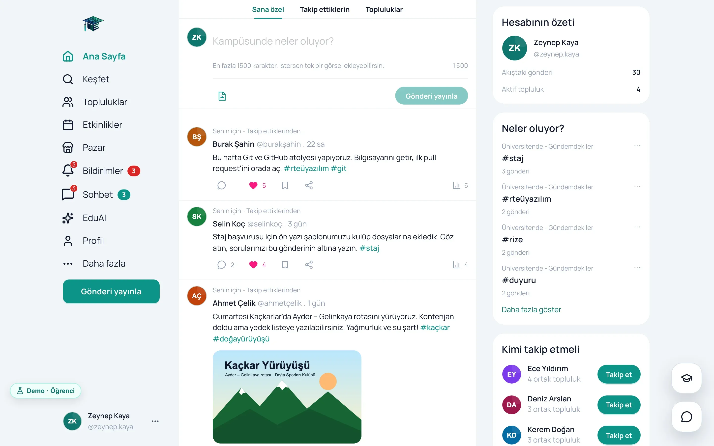
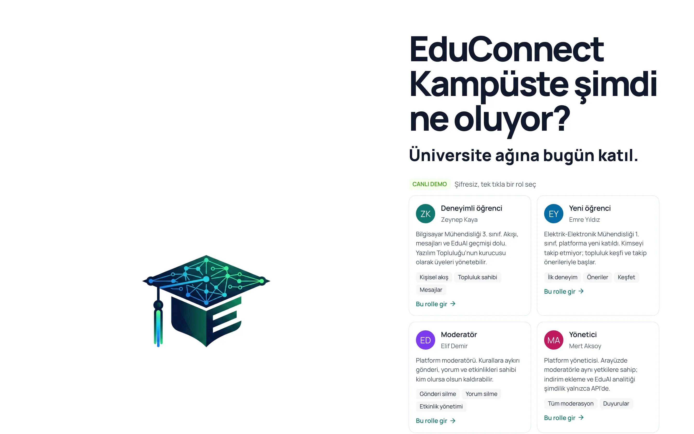
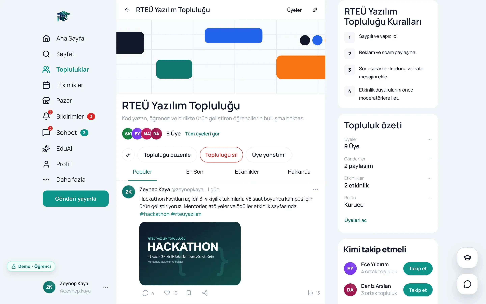
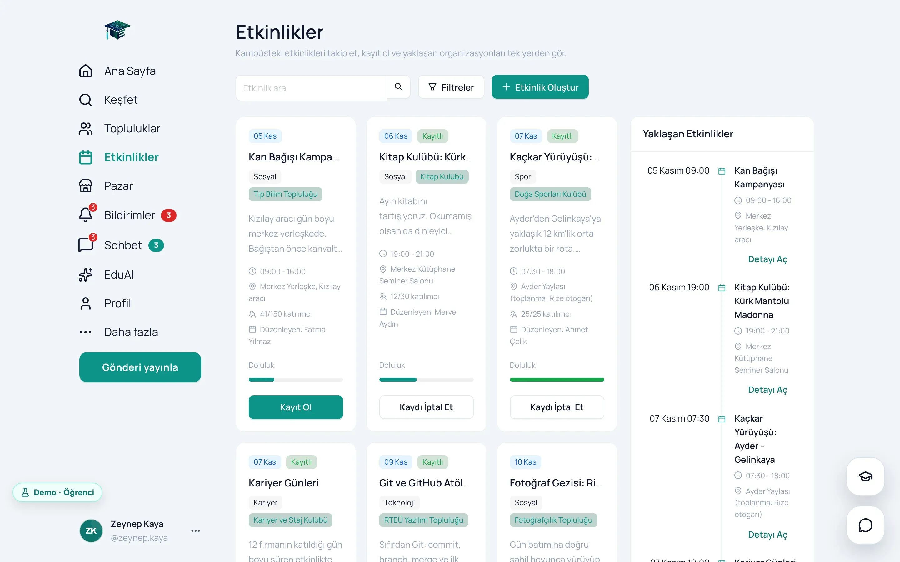
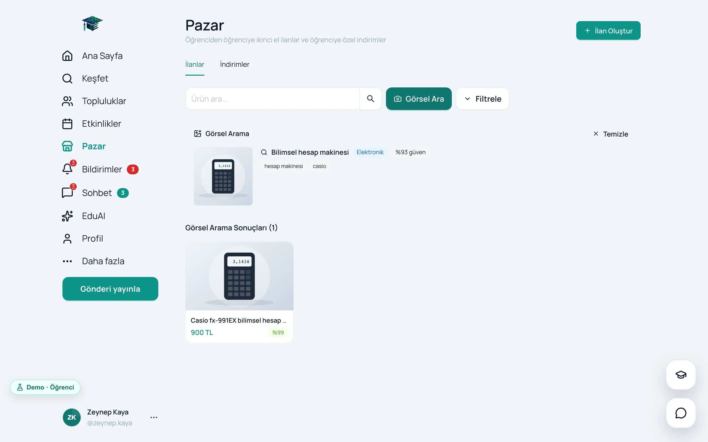
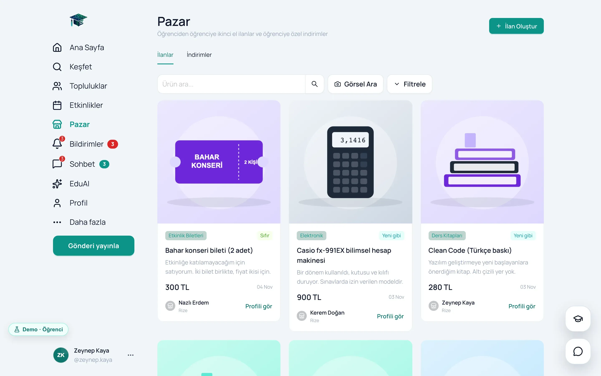
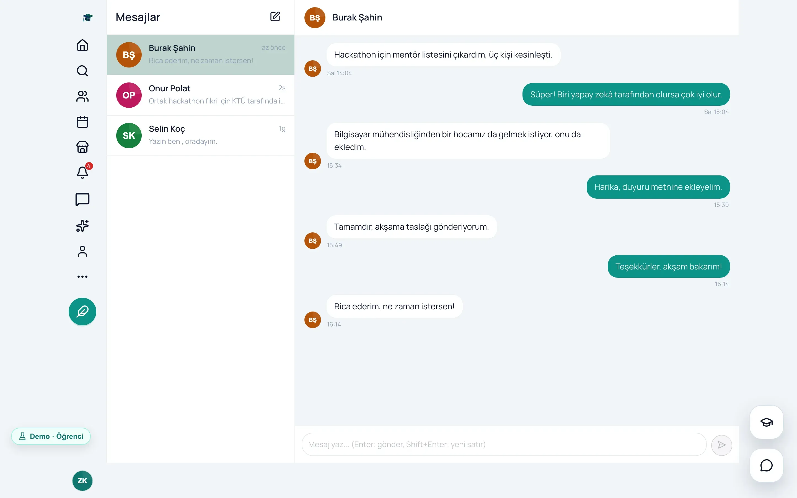
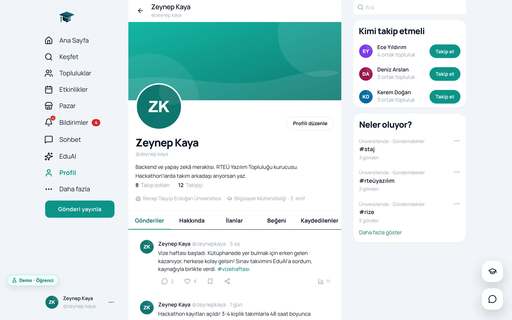
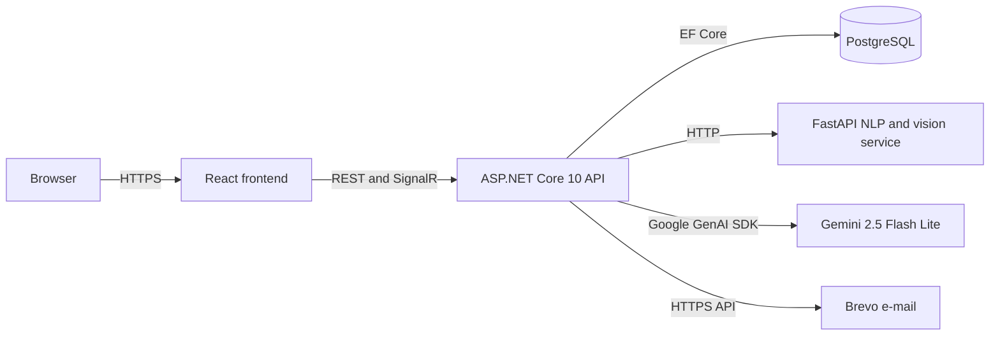

<p align="center">
  
</p>

# EduConnect

An AI-assisted campus platform for university students: a feed, communities, events, a second-hand market, messaging
and an assistant (EduAI) that answers questions based on official sources.

[](docs/en/01-story.md)


**[Live demo](https://educonnect-tez.vercel.app)** · **[Documentation](docs/en/README.md)** ·
**[Frontend repository](https://github.com/mrfiratatalay/educonnect-frontend)** · **[Türkçe](README.md)**

Ayşe Mandıralı and I built EduConnect as our graduation thesis in the Computer Engineering department of Recep Tayyip
Erdoğan University, and the project was supported by TÜBİTAK 2209-A. Campus life was scattered across WhatsApp
groups, general social media and long PDF announcements. We brought it together on one platform that you can only
join with an institutional e-mail address. Its most original part is EduAI: a BERTurk model we fine-tuned on our own
dataset classifies the question, a 412-entry knowledge base finds the answer, and Gemini explains it in the user's
words. Every answer shows its source and a confidence band.

This repository holds the ASP.NET Core 10 API and the AI service written in Python. In November 2026 I reread the
project from start to finish. I turned the live site into a demo that runs in the browser, fixed three bugs, reduced
the local setup to one command and rewrote the documentation, checking every claim against the code. The documents
explain each decision in the same order: problem, solution, reasoning and cost.

## How to review it

| Time | What to do |
|---|---|
| 1 minute | Open the [live demo](https://educonnect-tez.vercel.app) and click a role card. No setup, account or password |
| 5 minutes | [Demo tour](docs/en/02-demo-tour.md): a step-by-step tour with four roles |
| 15 minutes | [Architecture](docs/en/03-architecture.md) and [Problems I solved](docs/en/11-problems-i-solved.md) |
| The real system | `docker compose up --build`; details in [Running and API](docs/en/10-running-and-api.md) |

The UI is in Turkish; the [demo tour](docs/en/02-demo-tour.md) gives the English meaning of every label it uses.

## Story

We submitted the project in May 2026. In November I opened the live address: the UI loaded, but nobody could log in,
because Render's free database had expired. While preparing the project for my portfolio I fixed that first and then
reread the code from the start. The full story is in [Story](docs/en/01-story.md).

| | At submission (May 2026) | After this revision |
|---|---|---|
| **Live site** | No login possible because the database had expired | A demo with one-click, password-free login for every role |
| **Local setup** | Windows scripts; the compose file in the README was not in the repository | `docker compose up --build` |
| **Without a Gemini key** | EduAI and visual search returned 500 | Answers come from the local knowledge base |
| **Live notifications** | The notification hub did not read the token | Fixed |
| **Documentation** | Short notes describing controllers that did not exist | 12 documents verified against the code, in Turkish and English |

## Screenshots

The screenshots come from the demo build, which runs the same code as the live demo.

| Landing page and role cards | Personalized feed |
|---|---|
|  |  |
| **Community** | **Events** |
|  |  |
| **EduAI, with its source** | **Visual search** |
|  |  |
| **Market** | **Messages** |
|  |  |
| **Profile** | **Dark theme** |
|  |  |

| Feed on a phone | Community on a phone | EduAI on a phone |
|---|---|---|
|  |  |  |

## Engineering highlights

1. **A demo that runs in the browser.** The axios adapter changes, the screens stay the same, and the real build
   contains no demo code at all. → [Deployment strategy](docs/en/09-deployment-strategy.md)
2. **An assistant that shows its source.** Intent with BERTurk, the answer from a 412-entry knowledge base, the wording
   from Gemini; a confidence band and a source link with every answer. → [AI](docs/en/07-ai.md)
3. **Any external service can fail.** If the NLP service is down, a fallback result takes over; if Gemini is down, the
   local knowledge base does. The system also runs without a Gemini key. → [AI](docs/en/07-ai.md)
4. **Atomic refresh token rotation.** A single `UPDATE ... WHERE`; a parallel second request with the same token gets
   a clean 401. → [Security](docs/en/06-security.md)
5. **The database settles the races.** Likes, bookmarks, follows and memberships are protected by unique indexes, and
   error `23505` is read as "already done". → [Database](docs/en/04-database.md)
6. **Explainable visual search.** Gemini's image analysis is combined with ResNet-50 similarity, and every result
   comes with a score breakdown. → [AI](docs/en/07-ai.md)
7. **A feed that explains itself.** The "for you" ranking is scored with 10 signals, and every post says why it was
   recommended. → [Domain rules](docs/en/05-domain-rules.md)
8. **Institutional e-mail verification.** A 6-digit code, a SHA-256 hash, a 10-minute lifetime, 5 attempts and a
   60-second cooldown. → [Security](docs/en/06-security.md)
9. **An architecture shaped by free tiers.** 512 MB of memory moved the AI into a separate service, and blocked SMTP
   ports moved e-mail to Brevo's HTTPS API. → [Deployment strategy](docs/en/09-deployment-strategy.md)
10. **From SQL Server to PostgreSQL.** One migration instead of 11, and a data copy tool that turns off foreign key
    triggers for the session. → [Problems I solved](docs/en/11-problems-i-solved.md)
11. **Real time.** Three SignalR hubs, the JWT in a query parameter for WebSockets, and polling as a safety net when the
    connection drops. → [Architecture](docs/en/03-architecture.md)
12. **Honest limits.** No tests yet and oversized controllers; the full list and the roadmap have their own document.
    → [FAQ and limits](docs/en/12-faq-and-limits.md)

## Architecture



| Layer | Technologies |
|---|---|
| API | .NET 10, ASP.NET Core 10, EF Core 10, Npgsql 10, SignalR, JwtBearer 10.0.5, Swashbuckle 10.1.5, Google.GenAI 1.5.0 |
| Database | PostgreSQL (16 locally) |
| AI service | Python 3.11, FastAPI, PyTorch 2.5 (CPU only), Transformers, BERTurk, ResNet-50 |
| Frontend | React 19.2, TypeScript 5.9, Vite 8, Ant Design 6.3, TanStack Query 5.95, Zustand 5 |
| Infrastructure | Docker, Render, Hugging Face Spaces, Vercel, Brevo |

The backend has four projects (Domain, Application, Infrastructure, Api): 27 tables, 15 controllers and 89 endpoints.
Details in [Architecture](docs/en/03-architecture.md).

## Run it with one command

```bash
git clone https://github.com/mrfiratatalay/educonnect-backend.git
cd educonnect-backend
docker compose up --build
```

Swagger is at http://localhost:5160/swagger and verification e-mails at http://localhost:8025. No secrets are needed;
by default the NLP service is the live Space on Hugging Face. Running the frontend, the environment variables and curl
examples with real outputs are in [Running and API](docs/en/10-running-and-api.md).

## Documentation

| # | Document | What is inside |
|---|---|---|
| 01 | [Story](docs/en/01-story.md) | How it started, the team, the timeline, before and after |
| 02 | [Demo tour](docs/en/02-demo-tour.md) | A 5-minute tour that needs no technical background |
| 03 | [Architecture](docs/en/03-architecture.md) | Three services, layers, modules, the journey of a request |
| 04 | [Database](docs/en/04-database.md) | 27 tables, the relationship diagram, rules the database enforces |
| 05 | [Domain rules](docs/en/05-domain-rules.md) | Registration, feed scoring, community roles, events and the market |
| 06 | [Security](docs/en/06-security.md) | JWT, refresh rotation, authorization, rate limits, known gaps |
| 07 | [AI](docs/en/07-ai.md) | EduAI and visual search |
| 08 | [Frontend and design](docs/en/08-frontend-and-design.md) | React architecture, server state, design language, mobile |
| 09 | [Deployment strategy](docs/en/09-deployment-strategy.md) | Zero-cost hosting, two channels, the demo and its cost |
| 10 | [Running and API](docs/en/10-running-and-api.md) | Setup, environment variables, curl examples |
| 11 | [Problems I solved](docs/en/11-problems-i-solved.md) | Twelve short stories |
| 12 | [FAQ and limits](docs/en/12-faq-and-limits.md) | Interview questions, known limits, roadmap |

## Project structure

```
educonnect-backend/
├── src/
│   ├── EduConnect.Domain/           27 entities, 6 enums
│   ├── EduConnect.Application/      request and response contracts, service interfaces
│   ├── EduConnect.Infrastructure/   EF Core, identity, Gemini, the NLP client, visual search, e-mail
│   └── EduConnect.Api/              15 controllers, 3 hubs, Program.cs, Dockerfile
├── nlp-service/                     FastAPI: BERTurk, the knowledge base, ResNet-50
├── tools/MigrateData/               the SQL Server to PostgreSQL data copy tool
├── scripts/                         start scripts for Windows
├── docs/                            Turkish documents; English ones under docs/en
└── docker-compose.yml               db, mail, api and the optional nlp service
```

## Team

**Fırat Atalay** (team captain) and **Ayşe Mandıralı**. As a two-person team we shared the work: design decisions,
the backend, the AI service, the frontend and deployment were our joint work. A large part of the code was written
together with AI coding assistants (Claude Code); we decided the architecture, the rules and what counted as correct.

**Thanks** to the TÜBİTAK 2209-A programme for its support; to the [dbmdz](https://huggingface.co/dbmdz) team for
sharing the BERTurk model; and to the people behind ASP.NET Core, EF Core, Npgsql, FastAPI, PyTorch, Transformers,
React and Ant Design.

**Notice.** Recep Tayyip Erdoğan University, TÜBİTAK, Gemini and other names are trademarks of their owners.
EduConnect is a student project, not an official service of the university. The knowledge base was compiled from
official sources, but it is not guaranteed to be up to date. The people and data in the demo are made up.

## License

[MIT](LICENSE) © 2026 Fırat Atalay, Ayşe Mandıralı
