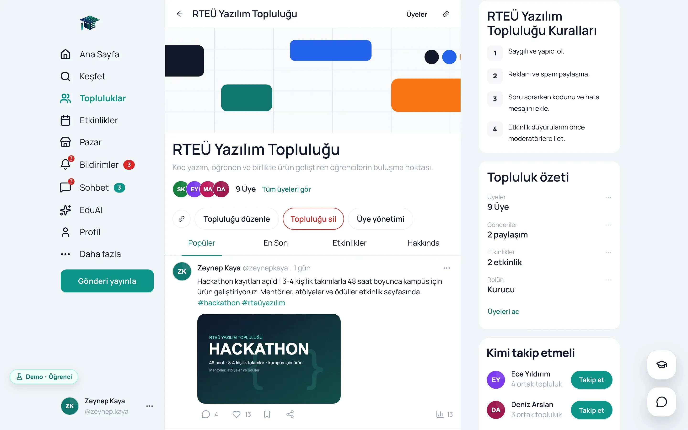
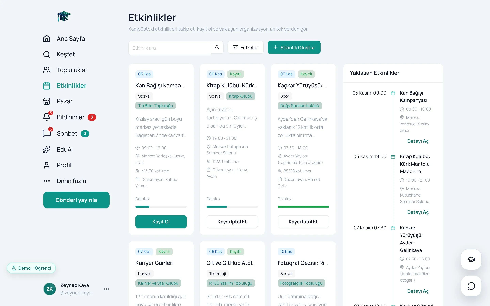
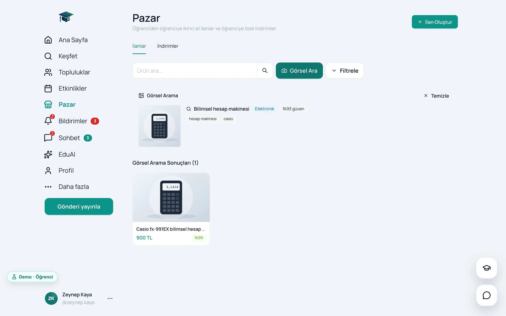
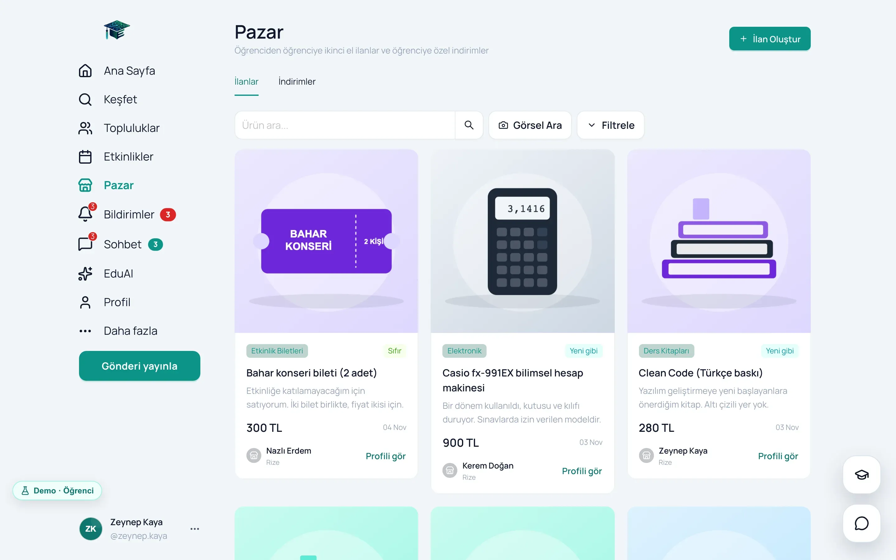
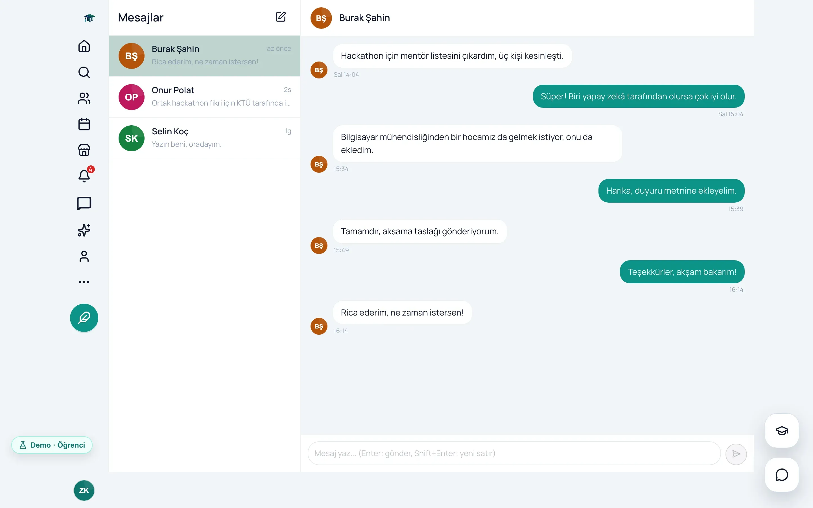
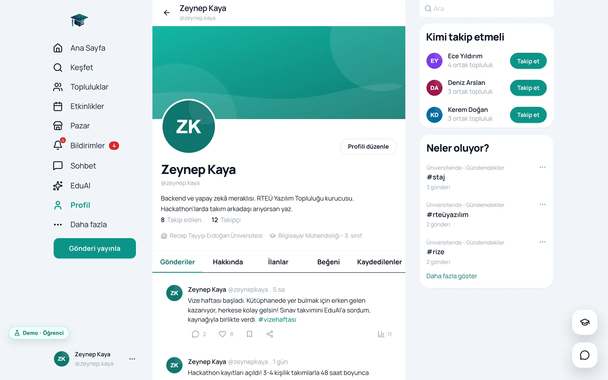
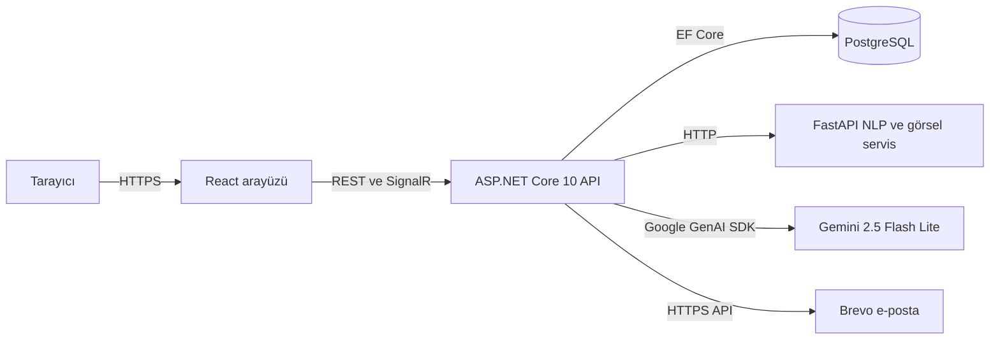

<p align="center">
  
</p>

# EduConnect

Üniversite öğrencileri için yapay zekâ destekli bir kampüs platformu: akış, topluluklar, etkinlikler, ikinci el pazar,
mesajlaşma ve resmî kaynaklara dayanarak cevap veren bir asistan (EduAI).

[](docs/01-hikaye.md)


**[Canlı demo](https://educonnect-tez.vercel.app)** · **[Dokümanlar](docs/README.md)** ·
**[Arayüz reposu](https://github.com/mrfiratatalay/educonnect-frontend)** · **[English](README.en.md)**

EduConnect'i Recep Tayyip Erdoğan Üniversitesi Bilgisayar Mühendisliği bölümünde Ayşe Mandıralı ile birlikte bitirme
tezimiz olarak geliştirdik; proje TÜBİTAK 2209-A kapsamında desteklendi. Kampüs hayatı WhatsApp grupları, genel sosyal
medya ve uzun PDF duyuruları arasında dağılmıştı. Biz bunu, yalnızca kurumsal e-postayla girilebilen tek bir platformda
topladık. En özgün parçası EduAI: kendi veri setimizle ince ayardan geçirdiğimiz BERTurk modeli soruyu sınıflandırıyor,
412 kayıtlık bilgi tabanı cevabı buluyor, Gemini de bunu kullanıcının diliyle anlatıyor. Her cevapta kaynak ve güven
bandı görünüyor.

Bu repo ASP.NET Core 10 API'sini ve Python ile yazılmış yapay zekâ servisini içeriyor. Kasım 2026'da projeyi baştan
sona yeniden okudum. Canlı siteyi tarayıcıda çalışan bir demoya çevirdim, üç hata düzelttim, yerel kurulumu tek komuta
indirdim ve dokümanları koddan doğrulayarak yeniden yazdım. Dokümanlarda her kararı problem, çözüm, neden ve bedel
sırasıyla anlattım.

## Nasıl incelersin?

| Süre | Ne yapmalı? |
|---|---|
| 1 dakika | [Canlı demoyu](https://educonnect-tez.vercel.app) aç ve bir rol kartına tıkla. Kurulum, hesap ve şifre yok |
| 5 dakika | [Demo turu](docs/02-demo-turu.md): dört rolle adım adım bir tur |
| 15 dakika | [Mimari](docs/03-mimari.md) ve [Çözdüğüm problemler](docs/11-cozdugum-problemler.md) |
| Gerçek sistem | `docker compose up --build`; ayrıntısı [Çalıştırma ve API](docs/10-calistirma-ve-api.md) dokümanında |

## Hikâye

Projeyi Mayıs 2026'da teslim ettik. Kasım'da canlı adrese girdiğimde arayüz açılıyordu ama giriş yapılamıyordu:
Render'daki ücretsiz veritabanının süresi dolmuştu. Projeyi portfolyom için yeniden ele alırken önce bu sorunu
çözdüm, sonra kodu baştan okudum. Bütün hikâye [Hikâye](docs/01-hikaye.md) dokümanında.

| | Teslimde (Mayıs 2026) | Bu düzenlemeden sonra |
|---|---|---|
| **Canlı site** | Süresi dolan veritabanı yüzünden giriş yapılamıyordu | Her rolle tek tıkla, şifresiz giriş yapılan bir demo |
| **Yerel kurulum** | Windows betikleri; README'deki compose dosyası repoda yoktu | `docker compose up --build` |
| **Gemini anahtarı yoksa** | EduAI ve görsel arama 500 dönüyordu | Cevap yerel bilgi tabanından geliyor |
| **Canlı bildirimler** | Bildirim hub'ı token'ı okumuyordu | Düzeltildi |
| **Dokümanlar** | Olmayan controller'ları anlatan kısa notlar | Koddan doğrulanmış 12 doküman, Türkçe ve İngilizce |

## Ekran görüntüleri

Görüntüler, canlı demoyla aynı kodu taşıyan demo derlemesinden alındı.

| Giriş ve rol kartları | Kişiselleştirilmiş akış |
|---|---|
|  |  |
| **Topluluk** | **Etkinlikler** |
|  |  |
| **EduAI, kaynağıyla** | **Görsel arama** |
|  |  |
| **Pazar** | **Mesajlar** |
|  |  |
| **Profil** | **Koyu tema** |
|  |  |

| Telefonda akış | Telefonda topluluk | Telefonda EduAI |
|---|---|---|
|  |  |  |

## Mühendislik tarafında öne çıkanlar

1. **Tarayıcıda çalışan demo.** axios'un adaptörü değişiyor, ekranlar aynı kalıyor; gerçek derlemede demo kodu hiç
   yok. → [Yayın stratejisi](docs/09-yayin-stratejisi.md)
2. **Kaynağını gösteren asistan.** BERTurk ile niyet, 412 kayıtlık bilgi tabanıyla cevap, Gemini ile anlatım; her
   cevapta güven bandı ve kaynak bağlantısı. → [Yapay zekâ](docs/07-yapay-zeka.md)
3. **Her dış servis düşebilir.** NLP servisi düşerse yedek sonuç, Gemini düşerse yerel bilgi tabanı devreye giriyor;
   sistem Gemini anahtarı olmadan da çalışıyor. → [Yapay zekâ](docs/07-yapay-zeka.md)
4. **Atomik refresh token rotasyonu.** Tek bir `UPDATE ... WHERE`; aynı token'la gelen paralel ikinci istek temiz
   bir 401 alıyor. → [Güvenlik](docs/06-guvenlik.md)
5. **Yarışları veritabanı çözüyor.** Beğeni, kaydetme, takip ve üyelik benzersiz indekslerle korunuyor; `23505`
   hatası "iş zaten yapılmış" diye yorumlanıyor. → [Veritabanı](docs/04-veritabani.md)
6. **Açıklanabilir görsel arama.** Gemini'nin görsel analizi ve ResNet-50 benzerliği birleşiyor; her sonucun puan
   dökümü dönüyor. → [Yapay zekâ](docs/07-yapay-zeka.md)
7. **Gerekçesini söyleyen akış.** "Sana özel" sıralaması 10 sinyalle puanlanıyor ve her gönderi neden önerildiğini
   yazıyor. → [İş kuralları](docs/05-is-kurallari.md)
8. **Kurumsal e-posta doğrulaması.** 6 haneli kod, SHA-256 özeti, 10 dakikalık ömür, 5 deneme ve 60 saniyelik
   bekleme. → [Güvenlik](docs/06-guvenlik.md)
9. **Ücretsiz katmanların şekillendirdiği mimari.** 512 MB bellek yapay zekâyı ayrı bir servise taşıdı, kapalı SMTP
   portları Brevo'nun HTTPS API'sine. → [Yayın stratejisi](docs/09-yayin-stratejisi.md)
10. **SQL Server'dan PostgreSQL'e.** 11 migration'ın yerine tek migration ve yabancı anahtarları geçici olarak
    kapatan bir veri taşıma aracı. → [Çözdüğüm problemler](docs/11-cozdugum-problemler.md)
11. **Gerçek zamanlılık.** Üç SignalR hub'ı, WebSocket'te sorgu parametresiyle gelen JWT ve bağlantı koparsa
    devreye giren yoklama. → [Mimari](docs/03-mimari.md)
12. **Dürüst sınırlar.** Test yok, controller'lar şişkin; tam liste ve yol haritası ayrı bir dokümanda.
    → [Sorular ve sınırlar](docs/12-sorular-ve-sinirlar.md)

## Mimari



| Katman | Teknolojiler |
|---|---|
| API | .NET 10, ASP.NET Core 10, EF Core 10, Npgsql 10, SignalR, JwtBearer 10.0.5, Swashbuckle 10.1.5, Google.GenAI 1.5.0 |
| Veritabanı | PostgreSQL (yerelde 16) |
| Yapay zekâ servisi | Python 3.11, FastAPI, PyTorch 2.5 (yalnızca CPU), Transformers, BERTurk, ResNet-50 |
| Arayüz | React 19.2, TypeScript 5.9, Vite 8, Ant Design 6.3, TanStack Query 5.95, Zustand 5 |
| Altyapı | Docker, Render, Hugging Face Spaces, Vercel, Brevo |

Backend dört projeden oluşuyor (Domain, Application, Infrastructure, Api): 27 tablo, 15 controller ve 89 uç nokta.
Ayrıntısı [Mimari](docs/03-mimari.md) dokümanında.

## Tek komutla çalıştırma

```bash
git clone https://github.com/mrfiratatalay/educonnect-backend.git
cd educonnect-backend
docker compose up --build
```

Swagger http://localhost:5160/swagger, doğrulama e-postaları http://localhost:8025 adresinde. Hiçbir sır gerekmiyor;
NLP servisi varsayılan olarak Hugging Face'teki canlı Space. Arayüzü çalıştırmak, ortam değişkenleri ve gerçek
çıktılarla curl örnekleri [Çalıştırma ve API](docs/10-calistirma-ve-api.md) dokümanında.

## Dokümanlar

| # | Doküman | İçinde ne var |
|---|---|---|
| 01 | [Hikâye](docs/01-hikaye.md) | Projenin doğuşu, ekip, zaman çizelgesi, önce ve sonra |
| 02 | [Demo turu](docs/02-demo-turu.md) | Teknik bilgi gerektirmeyen 5 dakikalık tur |
| 03 | [Mimari](docs/03-mimari.md) | Üç servis, katmanlar, modüller, bir isteğin yolculuğu |
| 04 | [Veritabanı](docs/04-veritabani.md) | 27 tablo, ilişki şeması, veritabanında korunan kurallar |
| 05 | [İş kuralları](docs/05-is-kurallari.md) | Kayıt, akış puanlaması, topluluk rolleri, etkinlik ve pazar |
| 06 | [Güvenlik](docs/06-guvenlik.md) | JWT, refresh rotasyonu, yetki, hız sınırı, bilinen eksikler |
| 07 | [Yapay zekâ](docs/07-yapay-zeka.md) | EduAI ve görsel arama |
| 08 | [Arayüz ve tasarım](docs/08-arayuz-ve-tasarim.md) | React mimarisi, sunucu durumu, tasarım dili, mobil |
| 09 | [Yayın stratejisi](docs/09-yayin-stratejisi.md) | Sıfır maliyetli yayın, iki kanal, demo ve bedeli |
| 10 | [Çalıştırma ve API](docs/10-calistirma-ve-api.md) | Kurulum, ortam değişkenleri, curl örnekleri |
| 11 | [Çözdüğüm problemler](docs/11-cozdugum-problemler.md) | On iki kısa hikâye |
| 12 | [Sorular ve sınırlar](docs/12-sorular-ve-sinirlar.md) | Mülakat soruları, bilinen sınırlar, yol haritası |

## Proje yapısı

```
educonnect-backend/
├── src/
│   ├── EduConnect.Domain/           27 entity, 6 enum
│   ├── EduConnect.Application/      istek ve yanıt sözleşmeleri, servis arayüzleri
│   ├── EduConnect.Infrastructure/   EF Core, kimlik, Gemini, NLP istemcisi, görsel arama, e-posta
│   └── EduConnect.Api/              15 controller, 3 hub, Program.cs, Dockerfile
├── nlp-service/                     FastAPI: BERTurk, bilgi tabanı, ResNet-50
├── tools/MigrateData/               SQL Server'dan PostgreSQL'e veri taşıma aracı
├── scripts/                         Windows için başlatma betikleri
├── docs/                            Türkçe dokümanlar; docs/en altında İngilizceleri
└── docker-compose.yml               db, mail, api ve isteğe bağlı nlp
```

## Ekip

EduConnect'i **Fırat Atalay** ve **Ayşe Mandıralı** birlikte geliştirdi. Bütün sorumlulukları paylaştık; kaptan ya
da tek bir sahip yoktu. Tasarım kararları, backend, yapay zekâ servisi, arayüz ve yayına alma ortak işimizdi.
Kodun önemli bir kısmı yapay zekâ kodlama asistanlarıyla (Claude Code) birlikte yazıldı; mimariyi, kuralları ve
doğruluğu biz belirledik.

**Teşekkürler.** Desteği için TÜBİTAK 2209-A programına; BERTurk modelini paylaşan [dbmdz](https://huggingface.co/dbmdz)
ekibine; ASP.NET Core, EF Core, Npgsql, FastAPI, PyTorch, Transformers, React ve Ant Design'ın geliştiricilerine.

**Uyarı.** Recep Tayyip Erdoğan Üniversitesi, TÜBİTAK, Gemini ve diğer adlar sahiplerinin markalarıdır. EduConnect bir
öğrenci projesi; üniversitenin resmî bir hizmeti değil. Bilgi tabanı resmî kaynaklardan derlendi ama güncelliği
garanti edilmiyor. Demodaki kişiler ve veriler uydurma.
