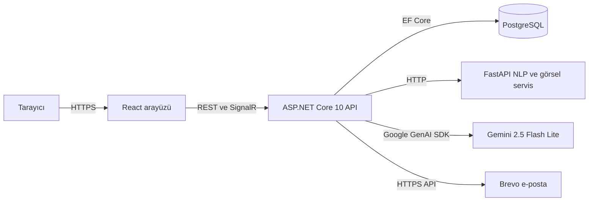
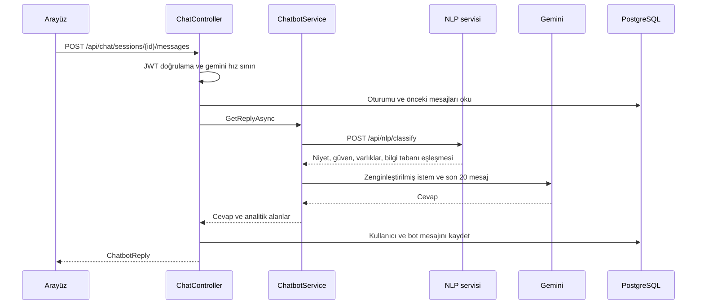

# Mimari

EduConnect üç ayrı serviste çalışıyor: React arayüzü, ASP.NET Core API ve Python ile yazılmış bir yapay zekâ
servisi. Bu dokümanda parçaların nasıl konuştuğunu, katmanları ve bir isteğin yolculuğunu anlatıyorum.

## Büyük resim

| Parça | Teknoloji | Nerede çalışıyor? |
|---|---|---|
| Arayüz | React 19, TypeScript, Vite 8, Ant Design 6 | Vercel (bugün tarayıcıda çalışan demo modunda) |
| API | .NET 10, ASP.NET Core 10, EF Core 10, SignalR | Render, Docker konteyneri |
| Veritabanı | PostgreSQL | Render (ücretsiz veritabanının süresi doldu) |
| NLP ve görsel servis | Python 3.11, FastAPI, PyTorch, Transformers | Hugging Face Spaces, Docker |
| Dil modeli | Gemini 2.5 Flash Lite | Google AI Studio |
| E-posta | Brevo HTTPS API, yedek olarak SMTP | Brevo |

Bu dağılımın nedenini ve bugünkü durumunu [Yayın stratejisi](09-yayin-stratejisi.md) dokümanında anlattım.

## Katmanlar

Backend dört projeden oluşuyor ([EduConnect.sln](../EduConnect.sln)). Bağımlılıklar içeri doğru akıyor: Domain
hiçbir projeye bağımlı değil, Api en dıştaki katman.

| Katman | Proje | İçinde ne var? |
|---|---|---|
| Domain | [EduConnect.Domain](../src/EduConnect.Domain) | 27 entity, 6 enum; dış bağımlılığı olmayan saf C# |
| Application | [EduConnect.Application](../src/EduConnect.Application) | İstek ve yanıt sözleşmeleri, servis arayüzleri |
| Infrastructure | [EduConnect.Infrastructure](../src/EduConnect.Infrastructure) | `AppDbContext`, migration, kimlik, Gemini, NLP istemcisi, görsel arama, dosya ve e-posta servisleri |
| Api | [EduConnect.Api](../src/EduConnect.Api) | 15 controller, 3 SignalR hub'ı, hata yakalayıcı, eşleyiciler, `Program.cs` |

**Dürüst olmak gerekirse:** Katmanlar kâğıt üzerinde temiz görünse de iş kurallarının çoğu controller'larda
duruyor ve controller'lar `AppDbContext`'i doğrudan kullanıyor. MediatR ve FluentValidation Application
katmanında kayıtlı ([DependencyInjection.cs](../src/EduConnect.Application/DependencyInjection.cs)) ama hiçbir
handler ya da validator yazılmadı. İki kişilik bir ekip olarak hızlı ilerlemeyi seçtik. Bunun bedeli büyük
dosyalar oldu: [PostsController](../src/EduConnect.Api/Controllers/PostsController.cs) 1.126 satır,
[GroupsController](../src/EduConnect.Api/Controllers/GroupsController.cs) 757 satır. Bugün baştan yazsaydım akış
puanlaması ve topluluk rolleri gibi kuralları test edilebilir uygulama servislerine taşırdım.

Karmaşık işler ise zaten servislere ayrılmış durumda: kimlik doğrulama
([AuthService](../src/EduConnect.Infrastructure/Services/AuthService.cs)), sohbet kararları
([ChatbotService](../src/EduConnect.Infrastructure/Services/ChatbotService.cs)) ve görsel arama
([VisualSearchService](../src/EduConnect.Infrastructure/Services/VisualSearchService.cs)).

## Modüller

| Modül | Controller | Uç nokta | Ne yapıyor? |
|---|---|---|---|
| Kimlik | `AuthController` | 7 | Kayıt, e-posta doğrulama, giriş, refresh, çıkış, şifremi unuttum |
| Kullanıcılar | `UsersController` | 12 | Profil, avatar ve kapak, arama, takip, takip önerileri |
| Gönderiler | `PostsController` | 17 | Akışlar, etiketler, beğeni, kaydetme, görüntülenme, yorum |
| Topluluklar | `GroupsController` | 18 | Topluluk, üyelik, roller, topluluk akışı, görseller |
| Etkinlikler | `EventsController` | 7 | Etkinlik, kayıt ve iptal, kontenjan |
| Keşfet | `ExploreController` | 1 | Canlı etiket trendleri ve öneriler |
| Pazar | `ProductsController`, `CategoriesController`, `DiscountsController` | 8 | İlanlar, kategoriler, öğrenci indirimleri |
| Görsel arama | `VisualSearchController` | 2 | Fotoğrafla benzer ilan bulma, arama geçmişi |
| Mesajlaşma | `ConversationsController` | 4 | Birebir sohbet ve mesajlar |
| Bildirimler | `NotificationsController` | 3 | Liste, okundu işaretleme |
| EduAI | `ChatController` | 8 | Oturum, mesaj, geri bildirim, yönetici analitiği |
| Diğer | `UniversitiesController`, `FeedbacksController` | 2 | Üniversite listesi, genel geri bildirim |

Toplam 89 controller uç noktası var; Swagger da 69 yol üzerinde 89 işlem gösteriyor. Bunlara ek olarak
`/health` ve üç SignalR hub'ı var.

## Bir isteğin yolculuğu: EduAI'a soru sormak

Gemini ya da NLP servisi cevap veremezse akış durmuyor; nasıl devam ettiğini [Yapay zekâ](07-yapay-zeka.md)
dokümanında adım adım anlattım.

## Gerçek zamanlılık

| Hub | Adres | Ne taşıyor? |
|---|---|---|
| [ChatHub](../src/EduConnect.Api/Hubs/ChatHub.cs) | `/hubs/chat` | EduAI'a hub üzerinden soru sorma (arayüz bugün REST kullanıyor) |
| [DirectMessageHub](../src/EduConnect.Api/Hubs/DirectMessageHub.cs) | `/hubs/direct-messages` | Yeni mesajı karşı tarafa `ReceiveMessage` olayıyla iletiyor |
| [NotificationHub](../src/EduConnect.Api/Hubs/NotificationHub.cs) | `/hubs/notifications` | Yeni bildirimi `NotificationReceived` olayıyla iletiyor |

Mesaj ve bildirim hub'ları boş sınıflar; olayları controller'lar `IHubContext` ile yayınlıyor
([NotificationPublisher](../src/EduConnect.Api/Common/NotificationPublisher.cs)). Tarayıcı WebSocket el
sıkışmasında başlık gönderemediği için JWT, `access_token` sorgu parametresiyle geliyor. Bildirim hub'ı bu
listede unutulmuştu; nasıl fark ettiğimi [Çözdüğüm problemler](11-cozdugum-problemler.md) dokümanında anlattım.
Arayüz bağlantı kuramazsa mesajları 30 saniyede, bildirimleri 60 saniyede bir yeniden çekiyor.

## Çalışma zamanı

[Program.cs](../src/EduConnect.Api/Program.cs) açılışta şunları yapıyor:

1. JWT doğrulamasını, CORS listesini, hız sınırlarını, SignalR'ı ve Problem Details tabanlı hata yakalayıcıyı
   kuruyor. Enum'lar JSON'da camelCase metin olarak dönüyor (`"moderator"` gibi).
2. Yüklenen dosyaları `/uploads` altından bir yıllık önbellek başlığıyla sunuyor.
3. Bekleyen migration'ları uygulayıp başlangıç verisini yüklüyor
   ([DbSeeder](../src/EduConnect.Infrastructure/Data/DbSeeder.cs)). Veritabanına ulaşamazsa uyarı yazıp yine de
   açılıyor; bu yüzden bugün canlı API `/health` için cevap verirken veri gerektiren her istek hata dönüyor.

Swagger her ortamda açık. Geliştirme ortamında Gemini'yi doğrudan denemek için iki test uç noktası da ekleniyor.

## Karar: Yapay zekâ neden ayrı bir serviste?

**Problem.** BERTurk sınıflandırıcısı ve ResNet-50, PyTorch ve Transformers kütüphaneleriyle birlikte
gigabaytlarca bellek istiyor. Render'ın ücretsiz sunucusu ise 512 MB.

**Çözüm.** Modelleri FastAPI ile yazılmış ayrı bir servise koyduk ve Hugging Face Spaces'te ücretsiz CPU
katmanında çalıştırdık. API bu servise iki dar sözleşmeyle bağlanıyor: `POST /api/nlp/classify` ve
`POST /api/vision/extract` ile `/similarity`.

**Neden.** Model değiştiğinde API'yi yeniden yayınlamak gerekmiyor; Python ekosistemi .NET'ten bağımsız
güncellenebiliyor. Docker imajında yalnızca CPU sürümlü PyTorch kullanarak imaj boyutunu da küçülttük.

**Bedeli.** Her EduAI sorusu ağ üzerinden bir çağrı daha demek. Uzun süre kullanılmayan Space uyuyor ve ilk
istek modeli belleğe yüklerken bekliyor. Bunu, servise ulaşılamazsa güvenli bir yedek sonuçla devam ederek
dengeledik ([NlpApiService](../src/EduConnect.Infrastructure/Services/NlpApiService.cs)).
