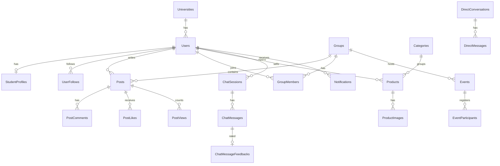

# Veritabanı

Veritabanı PostgreSQL; şema EF Core ile koddan üretiliyor. Bütün yapılandırma tek bir dosyada:
[AppDbContext.cs](../src/EduConnect.Infrastructure/Data/AppDbContext.cs). Toplam 27 tablo var ve her biri bir
entity'ye karşılık geliyor.

## İlişki şeması

Şemada en önemli ilişkiler var; tamamı `AppDbContext` içindeki `Configure...` metotlarında.

## Tablolar

| Grup | Tablolar | Sayı |
|---|---|---|
| Kimlik | `Users`, `StudentProfiles`, `Universities`, `RefreshTokens`, `UserFollows` | 5 |
| Paylaşım | `Posts`, `PostComments`, `PostLikes`, `PostBookmarks`, `PostViews` | 5 |
| Topluluk ve etkinlik | `Groups`, `GroupMembers`, `Events`, `EventParticipants` | 4 |
| Pazar | `Categories`, `Products`, `ProductImages`, `Discounts`, `VisualSearchHistories`, `VisualSearchResults` | 6 |
| Mesaj ve bildirim | `DirectConversations`, `DirectMessages`, `Notifications` | 3 |
| EduAI | `ChatSessions`, `ChatMessages`, `ChatMessageFeedbacks` | 3 |
| Diğer | `Feedbacks` | 1 |

## Önemli kararlar

### Zaman damgaları tek yerden

**Problem.** Her controller `CreatedAtUtc` ve `UpdatedAtUtc` alanlarını kendisi doldursaydı unutulan bir alan
yanlış sıralamaya yol açardı.

**Çözüm.** `AuditableEntity`'den türeyen her kayıt için `SaveChanges` ve `SaveChangesAsync` metotları bu alanları
merkezi olarak dolduruyor ([AppDbContext.cs](../src/EduConnect.Infrastructure/Data/AppDbContext.cs),
`ApplyAuditing`). Kimlikler (`Guid`) uygulamada üretiliyor.

**Bedeli.** `ExecuteUpdate` gibi toplu güncellemeler bu metodu atlıyor; bunları kullandığımız yerde
(refresh token, görsel embedding önbelleği) zaman damgası gerekmiyordu.

### Bir kullanıcı-gönderi çifti için tek beğeni

**Problem.** Aynı anda gelen iki beğeni isteği iki satır üretebilir ve sayaç şişer.

**Çözüm.** Kuralı veritabanına koyduk: `PostLikes`, `PostBookmarks` ve `PostViews` tablolarında
`(PostId, UserId)` çifti benzersiz. İkinci istek PostgreSQL'den `23505` hatası alıyor ve backend bunu "iş zaten
yapılmış" diye yorumluyor ([DbUpdateExceptionExtensions](../src/EduConnect.Infrastructure/Extensions/DbUpdateExceptionExtensions.cs)).

**Neden.** Uygulamada "önce kontrol et, sonra ekle" yapmak tek başına yetmiyor; iki istek kontrolü aynı anda
geçebiliyor. Benzersiz indeks, yarışı kazanana bakmadan doğru sonucu garanti ediyor.

### İki kişi arasında tek sohbet

**Problem.** "Ali-Ayşe" ve "Ayşe-Ali" iki ayrı sohbet olarak açılabilirdi.

**Çözüm.** `DirectConversations` tablosu iki kullanıcıyı `UserLowerId` ve `UserHigherId` olarak, yani her zaman
aynı sırayla saklıyor ve bu çift benzersiz. Sohbeti kim başlatırsa başlatsın aynı satır bulunuyor
([ConversationsController](../src/EduConnect.Api/Controllers/ConversationsController.cs)).

### Silmek yerine pasifleştirmek

Gönderiler `IsDeleted`, topluluklar ve ilanlar `IsActive` alanıyla pasifleşiyor. Silinen bir topluluğun
etkinlikleri ve gönderileri tarihçede kalıyor; akış sorguları bunları filtreliyor.

### Silme davranışları bilinçli seçildi

| Davranış | Nerede? | Neden? |
|---|---|---|
| `Restrict` | Kullanıcıya bağlı gönderi, yorum, beğeni, ilan | Bir kullanıcıyı silmek geçmişi sessizce yok etmesin |
| `Cascade` | Gönderinin yorumları ve beğenileri, sohbetin mesajları, oturumun mesajları | Ebeveyni olmadan anlamı olmayan kayıtlar |
| `SetNull` | `Posts.GroupId`, `Events.GroupId`, `Products.CategoryId` | Topluluk ya da kategori kalksa da kayıt yaşasın |

### Esnek alanlar metin olarak

Topluluk kuralları `RulesJson`, ürün görsellerinin ResNet-50 embedding'leri (2048 sayı) `EmbeddingJson` adıyla
metin kolonlarında JSON olarak duruyor. Basit tuttuk; bedeli, embedding'ler üzerinde veritabanı tarafında
benzerlik araması yapamamak. Büyük bir katalogda `pgvector` kullanırdım.

## Veritabanında korunan kurallar

| Kural | Nasıl? |
|---|---|
| Bir e-postayla tek hesap | `Users.Email` benzersiz |
| Bir refresh token tek kullanıcıya ait | `RefreshTokens.Token` benzersiz |
| Bir kullanıcı birini bir kez takip eder | `(FollowerUserId, FollowedUserId)` benzersiz |
| Tek beğeni, tek kaydetme, tek görüntülenme | `(PostId, UserId)` benzersiz |
| Bir topluluğa bir kez üye olunur | `(GroupId, UserId)` benzersiz |
| Bir etkinliğe bir kayıt | `(EventId, UserId)` benzersiz; iptal edilen kayıt yeniden etkinleşiyor |
| Topluluk adresi tekil | `Groups.Slug` benzersiz |
| Bir bot mesajına tek geri bildirim | `ChatMessageFeedbacks.ChatMessageId` benzersiz |

## SQL Server'dan PostgreSQL'e

Projeye SQL Server ile başladık; .NET dünyasında en yaygın seçim buydu. Yayına alırken Render'ın ücretsiz
katmanında SQL Server olmadığını gördük ve 26 Mayıs 2026'da PostgreSQL'e geçtik:

1. EF Core sağlayıcısını Npgsql'e çevirdik.
2. 11 SQL Server migration'ını silip tek bir `InitialPostgresCreate` migration'ı ürettik
   ([Migrations](../src/EduConnect.Infrastructure/Data/Migrations)).
3. Tipe özel eşlemeleri düzelttik: `nvarchar(max)` yerine `text`, `float` yerine `double precision`.
4. Npgsql'in katı `timestamp` davranışı yerine eski davranışı seçen anahtarı açtık; ayrıntısı
   [Çözdüğüm problemler](11-cozdugum-problemler.md) dokümanında.
5. Mevcut veriyi taşımak için tek seferlik bir konsol aracı yazdık: [tools/MigrateData](../tools/MigrateData).

API açılışta bekleyen migration'ları kendisi uyguluyor ve başlangıç verisini yüklüyor: 2 üniversite, 4 kategori,
1 yönetici hesabı ve 2 indirim ([DbSeeder](../src/EduConnect.Infrastructure/Data/DbSeeder.cs)). Yönetici hesabının
e-postası doğrulanmış olarak gelmiyor; yerelde nasıl doğrulanacağı [Çalıştırma ve API](10-calistirma-ve-api.md)
dokümanında.

## Bilinen eksikler

- **Etkinlik kontenjanı veritabanında korunmuyor.** Kontenjan uygulamada sayılıp kontrol ediliyor; aynı anda gelen
  iki kayıt kontenjanı bir kişi aşabilir. Satır kilidi (`SELECT ... FOR UPDATE`) ya da koşullu bir `INSERT` ile
  kapanır.
- **Akış sıralamasında tarih indeksi yok.** `Posts` tablosunda yalnızca yabancı anahtar indeksleri var; gönderi
  sayısı büyüdüğünde `CreatedAtUtc` üzerinde bir indeks gerekir.
- **Refresh token'lar düz metin saklanıyor.** Ayrıntısı [Güvenlik](06-guvenlik.md) dokümanında.
