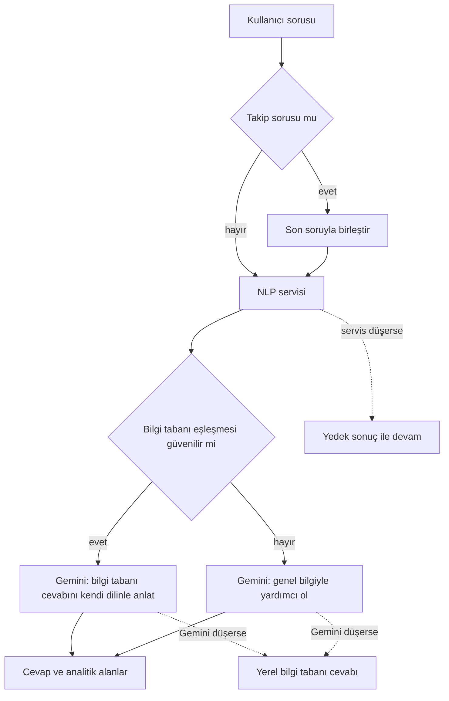

# Yapay zekâ: EduAI ve görsel arama

Projenin en özgün iki parçası burada. EduAI, üniversiteyle ilgili soruları resmî kaynaklara dayanarak cevaplayan
asistan. Görsel arama ise bir ürün fotoğrafından pazardaki benzer ilanları buluyor. İkisinde de modelin kendisi
kadar, model yanıldığında ya da servis düştüğünde ne olacağını tasarlamak önemliydi.

## EduAI'ın akışı



## 1. NLP servisi: niyet, varlık ve bilgi tabanı

[nlp-service](../nlp-service) klasöründeki FastAPI servisi, tek bir çağrıda üç iş yapıyor
([routers/nlp.py](../nlp-service/routers/nlp.py)):

**Niyet sınıflandırma.** `dbmdz/bert-base-turkish-cased` (BERTurk) modelini kendi veri setimizle ince ayardan
geçirdik ([train_intent.py](../nlp-service/training/train_intent.py)). 7 niyet var: sınav ve not, ders kaydı,
dijital sistemler, öğrenci işleri, kütüphane, öğrenci yaşamı, burs ve destek. Veri seti 1.739 örnekten oluşuyor.
3 epoch, 16'lık batch ve 2e-5 öğrenme oranıyla en iyi doğrulama doğruluğu **0,9626** oldu
([metrics.json](../nlp-service/models/intent_classifier/metrics.json)).

Bu sayıyı dikkatle okumak gerekiyor: veri setinin büyük kısmı kurallı biçimde üretilmiş ve çoğaltılmış cümleler,
doğrulama da bu dağılımın içinden ayrıldı. Gerçek öğrenci sorularındaki başarı daha düşük olabilir. Bunun için 60
zor vakalık ayrı bir test seti hazırladık ([phase_c_hard_test.json](../nlp-service/data/phase_c_hard_test.json));
sonuç raporunu repoya koymadık, o yüzden burada bir sayı vermiyorum.

**Modele güvenmemeyi bilmek.** [intent_service.py](../nlp-service/services/intent_service.py) şu kurallarla
çalışıyor:

- `metrics.json` içindeki doğruluk 0,60'ın altındaysa ya da model dosyası yüklenemezse servis BERTurk'ü hiç
  kullanmıyor; anahtar kelime sınıflandırıcısıyla açılıyor.
- Modelin güveni 0,60'ın altındaysa ya da ilk iki tahmin arasındaki fark 0,15'ten küçükse anahtar kelime
  sınıflandırıcısına da soruluyor (`hybrid-fallback`).
- Karışan alanlar için kural tabanlı bir çözücü var: "VPN" kütüphanenin uzaktan erişim terimleriyle birlikte
  geçmiyorsa dijital sistemlere, ÇAP ve yandal ders kaydına gidiyor.
- Güven bandı: 0,85 ve üstü yüksek, 0,60 ve üstü orta, altı düşük.

**Varlık çıkarma.** 9 grupta 105 takma ad (birimler, sistemler, belgeler, yerleşkeler...) ve "ne zaman", "saat
kaçta" gibi zaman ifadeleri metinde aranıyor ([entity_dictionary.json](../nlp-service/data/entity_dictionary.json)).

**Bilgi tabanı araması.** [knowledge_base.json](../nlp-service/data/knowledge_base.json) 412 kayıt içeriyor;
356'sı yüksek, 56'sı orta güvenli ve 61'i zamana duyarlı (tarih, ücret gibi değişebilen bilgiler). Kaynakların
çoğu üniversitenin resmî sayfaları; Öğrenci El Kitabı 2025, 2025-2026 akademik takvimi ve iletişim belgesi gibi
PDF'lerden derlendi. Bir kaydın puanı
([knowledge_service.py](../nlp-service/services/knowledge_service.py)):

| Bileşen | Ağırlık |
|---|---|
| Anahtar kelimelerin eşleşme oranı | 0,45 |
| Soru kelimeleriyle örtüşme | 0,25 |
| Konu terimleriyle örtüşme | 0,10 |
| Çıkarılan varlıkların metinde geçmesi | 0,20 |
| Sorunun birebir geçmesi / yüksek güvenli kayıt / zamana duyarlı kayıt | +0,10 / +0,05 / −0,05 |

Eşik 0,18; orta güvenli kayıtlar için 0,06, zamana duyarlı kayıtlar için 0,05 daha yüksek. Metin karşılaştırmadan
önce küçük harfe çevriliyor ve Türkçe karakterler sadeleştiriliyor.

## 2. Backend: kararı veren katman

[ChatbotService](../src/EduConnect.Infrastructure/Services/ChatbotService.cs) NLP sonucuna bakıp Gemini'ye nasıl
bir istem gideceğine karar veriyor.

**Bilgi tabanına dayanmak.** Bir cevap şu koşullarda "dayanaklı" sayılıyor: eşleşme puanı en az 0,40; orta
güvenli ve zamana duyarlı bir kayıt değil; niyet güveni en az 0,70 ya da puan en az 0,35. Dayanaklıysa Gemini'den
bilgi tabanı cevabını kullanıcının diliyle anlatması isteniyor. Değilse genel bilgisiyle yardımcı olması, zayıf
eşleşmeyi de yalnızca ipucu olarak kullanması isteniyor.

**Yönlendirme cevaplarını yakalamak.** Bilgi tabanında "duyurulardan takip ediniz" gibi somut bilgi içermeyen
kayıtlar vardı. 300 karakterden kısa ve bu tür ifadeler içeren bir cevap "yönlendirme" sayılıyor; Gemini'den bunu
tekrarlamak yerine somut bir cevap vermesi ve bağlantıyı yalnızca kaynak olarak eklemesi isteniyor
(`IsDeflectingKbAnswer`).

**Takip soruları.** "Biraz daha açıklar mısın?" tek başına anlamsız. Mesaj kısa ya da tipik bir takip ifadesi
içeriyorsa sınıflandırıcıya son soruyla birlikte gönderiliyor, Gemini'ye de önceki cevabı tekrarlamaması
söyleniyor. Gemini'ye son 20 mesaj geçmiş olarak gidiyor.

**Bağlantılar.** Model bazen bağlantıyı `oidb.erdogan.edu.tr` gibi şemasız yazıyor. Cevaptaki bağlantılar
`https://` ile tamamlanıyor ki arayüzde tıklanabilsin.

**Analitik.** Her bot mesajıyla birlikte niyet, güven, kullanılan model, bilgi tabanı puanı, eşleşme olup olmadığı,
yedek yola düşülüp düşülmediği ve gecikme saklanıyor. Yöneticiye özel `GET /api/chat/analytics/summary` bu
verilerden yardımcı olma oranını, bilgi tabanı isabet oranını, niyet dağılımını ve çözülemeyen son 20 soruyu
çıkarıyor. Dürüst bir not: geri bildirim (beğendim/beğenmedim) uç noktası hazır ama arayüz henüz çağırmıyor;
analitik için de bir ekran yok.

## 3. Bir şey bozulduğunda

| Ne oldu? | Ne yapılıyor? | Kullanıcı ne görüyor? |
|---|---|---|
| NLP servisine ulaşılamadı | Niyet `student_services`, güven 0,3, model `fallback` | Gemini yine cevap veriyor; güven bandı düşük |
| Gemini cevap vermedi ya da kota doldu | Yerel cevap: dayanaklıysa bilgi tabanı cevabı ve kaynak | Model etiketi `...+local-kb` |
| Gemini yok, eşleşme zayıf | "Tam emin değilim ama..." diye başlayan yakın cevap | Kaynak bağlantısıyla birlikte |
| İkisi de yok | Kısa bir özür mesajı | Boş ekran yok |

Bunu yerel kurulumda, Gemini anahtarı vermeden denedim. Hugging Face'teki gerçek servis soruyu sınıflandırdı,
cevap bilgi tabanından geldi:

```json
{
  "intentDetected": "library",
  "confidence": 0.885,
  "confidenceBand": "high",
  "modelUsed": "berturk-finetuned+local-kb",
  "kbScore": 0.6583,
  "kbHit": true,
  "latencyMs": 1686
}
```

Bu denemeden önce anahtarsız kurulumda EduAI hiç çalışmıyordu; nedenini
[Çözdüğüm problemler](11-cozdugum-problemler.md) dokümanında anlattım.

**Bedel.** Sistem istemi, Gemini'den bilmediği konularda "tipik" bir tahmin vermesini ve kesin olmayan noktayı
sonda tek cümleyle belirtmesini istiyor. Bu, kullanıcının eli boş dönmesini engelliyor ama yanlış bilgi riskini
artırıyor. Riski güven bandını, bilgi tabanı etiketini ve kaynak bağlantısını her cevapta göstererek azaltmaya
çalıştık.

## Görsel arama

Kullanıcı bir fotoğraf yüklüyor, sistem pazardaki benzer ilanları sıralıyor
([VisualSearchService](../src/EduConnect.Infrastructure/Services/VisualSearchService.cs)).

1. **Paralel iki analiz.** Gemini görseli JSON olarak tarif ediyor (ürün adı, kategori, anahtar kelimeler, durum,
   tahmini fiyat aralığı). Aynı anda NLP servisi ResNet-50 ile 2048 boyutlu bir görsel vektör çıkarıyor.
2. **Adaylar.** Görseli olan aktif ilanlar; kategori, fiyat ve şehir filtreleri uygulanıyor.
3. **Sezgisel puan.** Metin 0,40, kategori 0,30, durum 0,15 ve fiyat yakınlığı 0,15 ağırlıkla birleşiyor
   ([VisualSearchScoringHelper](../src/EduConnect.Infrastructure/Services/VisualSearchScoringHelper.cs)).
4. **Görsel benzerlik.** İlan görsellerinin vektörleriyle kosinüs benzerliği hesaplanıyor. İki puan da varsa toplam
   = 0,45 × sezgisel + 0,55 × görsel.
5. **Eşik.** Katı modda 0,42 ve ayrıca görsel benzerlik en az 0,55 ya da metin puanı en az 0,08; keşif modunda 0,32.
   Keşif modunda hiçbir ilan eşiği geçmezse en yakınlar yine gösteriliyor.
6. **Açıklanabilirlik.** Her sonucun yanında puan dökümü (kategori, metin, durum, fiyat, görsel) ve eşleşen
   sinyaller dönüyor.

**Tembel önbellek.** Bir ilan görselinin vektörü ilk aramada hesaplanıp `EmbeddingJson` kolonuna tek bir
`ExecuteUpdate` ile yazılıyor; sonraki aramalar hazır vektörü kullanıyor.

**Bedeli.** Benzerlik her aramada bütün adaylar için hesaplanıyor ve vektörler veritabanında metin olarak duruyor.
Öğrenci pazarı ölçeğinde yeterli; binlerce ilan olsaydı `pgvector` ve yaklaşık en yakın komşu araması gerekirdi.
Gemini ya da görsel servis düşerse arama durmuyor; yalnızca sezgisel puanla devam ediyor.

## Demoda ne çalışıyor?

Tarayıcıda BERTurk ya da Gemini çalıştırmak mümkün değil. Canlı demo, gerçek sistemin Gemini'siz yedek yolunu
tarayıcıya taşıyor: anahtar kelime sınıflandırıcısının ve bilgi tabanı puanlamasının TypeScript'e çevrilmiş hâli,
aynı 412 kayıtla çalışıyor
([engine.ts](https://github.com/mrfiratatalay/educonnect-frontend/blob/main/src/demo/eduai/engine.ts)).

Bilinçli iki fark var. Demo, Türkçe karakterleri sınıflandırmadan önce sadeleştiriyor. Tahmin edilen niyette
eşleşme bulamazsa bilgi tabanının tamamında arıyor. Python'daki anahtar kelime yedeği Türkçe karakterleri
sadeleştirmiyor; bu da gerçek sistemdeki bilinen bir zayıflık. Görsel arama demoda ürünü dosya adından tahmin
ediyor, ama sıralamada backend'in sezgisel puanlamasının birebir kopyasını kullanıyor.
