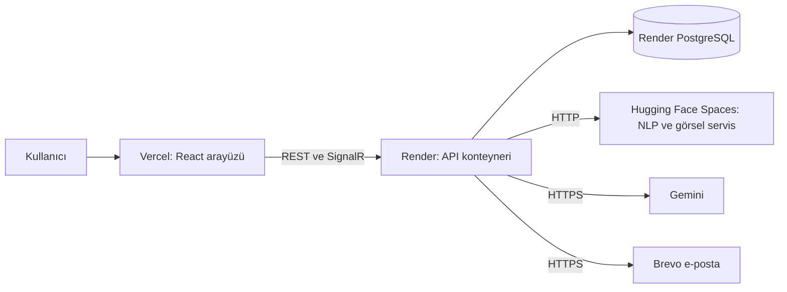
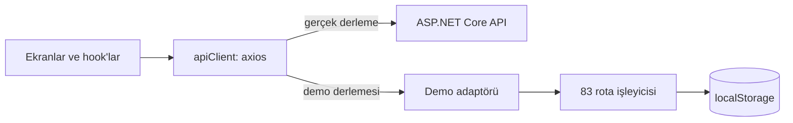

# Yayın stratejisi

EduConnect'i hiç para harcamadan yayında tuttuk. Bu dokümanda ücretsiz katmanların mimariyi nasıl şekillendirdiğini,
Kasım 2026'da canlı siteyi neden tarayıcıda çalışan bir demoya çevirdiğimi ve bunun bedelini anlatıyorum.

## Mayıs 2026: üç ücretsiz sağlayıcı



| Parça | Sağlayıcı | Ücretsiz katmanın kısıtı | Kısıt neye dönüştü? |
|---|---|---|---|
| Arayüz | Vercel | Statik site için yeterli | `main` dalına her push otomatik yayın |
| API | Render, Docker | 512 MB bellek; boşta kalınca uyuyor | Yapay zekâ modelleri ayrı bir servise taşındı |
| Veritabanı | Render PostgreSQL | Süresi doluyor | SQL Server'dan PostgreSQL'e geçtik; süre dolunca site boş kaldı |
| NLP ve görsel servis | Hugging Face Spaces | Yalnızca CPU; boşta kalınca uyuyor | Yalnızca CPU sürümlü PyTorch; servis düşerse yedek sonuç |
| E-posta | Brevo | Render SMTP portlarını kapatıyor | Gönderim HTTPS API ile, SMTP yedekte |
| Dil modeli | Gemini (Google AI Studio) | Kota | Dakikada 30 istek sınırı ve yerel bilgi tabanı yedeği |

İki Docker imajı var:

- **API:** [Dockerfile](../src/EduConnect.Api/Dockerfile) iki aşamalı. `sdk:10.0` ile derleniyor, `aspnet:10.0`
  üzerinde 8080 portunda çalışıyor.
- **NLP servisi:** [nlp-service/Dockerfile](../nlp-service/Dockerfile) `python:3.11-slim` üzerine yalnızca CPU
  sürümlü PyTorch 2.5 kuruyor ve Hugging Face Spaces'in beklediği 7860 portunu açıyor. CUDA'lı PyTorch'u
  kurmamak imajı küçültüyor.

E-posta servisi önce Brevo anahtarına bakıyor; anahtar varsa HTTPS API'yi, yoksa SMTP'yi kullanıyor
([EmailService](../src/EduConnect.Infrastructure/Services/EmailService.cs)). Yerel kurulumda SMTP, Mailpit'e
gidiyor.

## Kasım 2026: canlı site boş açılıyordu

Projeyi teslim ettikten birkaç ay sonra canlı adrese girdiğimde arayüz açılıyordu ama giriş yapılamıyordu.
Render'daki ücretsiz veritabanının süresi dolmuştu. API `/health` için 200 dönüyordu; veri isteyen her uç nokta ise
yaklaşık 26 saniye bekleyip hata veriyordu:

```json
{"title":"Invalid Operation","status":400,"detail":"An exception has been raised that is likely due to a transient failure."}
```

Bir İK uzmanının ya da mülakatçının bağlantıya tıklayıp bunu görmesi, projenin hiç çalışmadığını düşünmesi demekti.
Sunucu ve veritabanı için her ay ödeme yapmak ise yeni mezun olarak karşılayamayacağım bir maliyetti.

## Çözüm: iki kanal

| Kanal | Kim için? | Ne var? |
|---|---|---|
| **Canlı demo** | İK uzmanları, ilk kez bakan herkes | Vercel'de, backend'siz; her rolle tek tıkla giriş, örnek verilerle dolu |
| **Gerçek sistem** | Mühendisler | Kod, bu dokümanlar ve tek komutla yerel kurulum (`docker compose up --build`) |

## Demo nasıl çalışıyor?



**Taşıma katmanında değiştirmek.** Demo, axios'un adaptörünü değiştiriyor. Ekranlar ve hook'lar aynı adresleri
çağırıyor, aynı alan adlarını ve aynı hata kodlarını alıyor
([adapter.ts](https://github.com/mrfiratatalay/educonnect-frontend/blob/main/src/demo/adapter.ts)). Adaptör isteği
tarayıcıdaki bir rota işleyicisine yönlendiriyor; 9 dosyada 83 rota var. Davranış gerçek API'ye benzesin diye her
cevaptan önce 90 ile 250 ms arasında rastgele bir bekleme var. Korumalı bir uç noktaya token'sız gelen istek 401,
demoda olmayan bir uç nokta 404 alıyor.

**Anlık olaylar.** SignalR yerine tarayıcı içinde bir olay yolu var
([realtime.ts](https://github.com/mrfiratatalay/educonnect-frontend/blob/main/src/demo/realtime.ts)). Olaylar
gerçek hub'lardaki adları ve veri biçimini taşıyor (`ReceiveMessage`, `NotificationReceived`). Bir mesaj
gönderince karşı taraf birkaç saniye içinde cevap veriyor ve bildirim sayısı artıyor.

**Veri.** Örnek veri ilk açılışta üretilip `localStorage`'a, `educonnect-demo-db` anahtarına yazılıyor: 16 kullanıcı,
7 topluluk, 30 gönderi, 8 etkinlik, 13 ilan, 5 indirim, 11 bildirim, 4 sohbet ve 1 EduAI oturumu. İsimler Türkçe ve
uydurma; gerçek kişisel veri yok. E-postalar `@demo.erdogan.edu.tr` alan adında.

**Demo hiç eskimiyor.** Bütün tarihler açılış anına göre üretiliyor. Ziyaretçi günler sonra geri gelirse kayıtlı
bütün tarihler geçen tam gün sayısı kadar ileri kaydırılıyor
([db.ts](https://github.com/mrfiratatalay/educonnect-frontend/blob/main/src/demo/db.ts),
[time.ts](https://github.com/mrfiratatalay/educonnect-frontend/blob/main/src/demo/time.ts)). Saatler kaydırılmıyor,
ama bir gönderi yine birkaç saat önce paylaşılmış, gelecek haftaki etkinlik yine gelecek hafta görünüyor.

**Gerçek derlemede iz yok.** `__DEMO_MODE__` Vite'ın `define` ayarıyla derleme sırasında sabite dönüşüyor
([vite.config.ts](https://github.com/mrfiratatalay/educonnect-frontend/blob/main/vite.config.ts)). Gerçek derlemede
değeri `false` olduğu için demo dalları ve dinamik içe aktarmalar paketten tamamen çıkıyor; bunu derlenmiş
dosyalarda arayarak doğruladım. Demo derlemesinde ana paket yalnızca 8 KB büyüyor. Demo backend'i ilk istekte
ayrı parçalar hâlinde yükleniyor:

| Parça | Boyut | gzip |
|---|---|---|
| Demo adaptörü ve işleyiciler | 95,8 KB | 32,5 KB |
| Bilgi tabanı (412 kayıt) | 238,6 KB | 54 KB |
| Varlık takma adları | 6,8 KB | 1,2 KB |

**Yayın.** [vercel.json](https://github.com/mrfiratatalay/educonnect-frontend/blob/main/vercel.json) Vercel'e iki şey
söylüyor: `npm run build:demo` ile derle ve bütün adresleri `index.html`'e yönlendir. İkincisi sayesinde `/market`
gibi bir adreste sayfa yenilenince 404 yerine uygulama açılıyor.

## Bedeli

| Vazgeçtiğim şey | Neden kabul edilebilir? | Riski nasıl azalttım? |
|---|---|---|
| Canlı adresteki sistem gerçek backend değil | İK için önemli olan ürünü denemek; mühendis gerçek sistemi tek komutla çalıştırabiliyor | Demo her ekranda açıkça yazıyor; farklar [Demo turu](02-demo-turu.md) dokümanında tablo hâlinde |
| İki "backend"in bakımı | API değişirse demo işleyicileri de değişmeli | Ekran kodu ortak. Kalan risk: demo cevaplarını uygulamanın tipleri değil eşleyiciler (`mappers.ts`) belirliyor, uyumsuzluğu derleyici yakalamıyor |
| Demoda EduAI, BERTurk değil | Tarayıcıda model çalıştırmak pratik değil | Gerçek sistemin Gemini'siz yedek yolu aynı 412 kayıtla çalışıyor |
| Görsel aramada gerçek görüntü analizi yok | Gemini ve ResNet-50 tarayıcıda yok | Ürün dosya adından tahmin ediliyor; sıralama backend'in sezgisel puanlamasının kopyası |
| Demo derlemesi biraz daha büyük | Ana paket yalnızca 8 KB büyüyor | Demo kodu ayrı parçalarda ve gerçek derlemede hiç yok |

Demo eşleyicilerini uygulamanın kendi tiplerine (`src/types`) bağlamak, bu listedeki ilk iş.

## Gerçek sistem: tek komut

[docker-compose.yml](../docker-compose.yml) dört servis tanımlıyor:

| Servis | İmaj | Port |
|---|---|---|
| `db` | `postgres:16-alpine` | 5433 |
| `mail` | `axllent/mailpit:v1.27` | 8025 |
| `api` | [src/EduConnect.Api/Dockerfile](../src/EduConnect.Api/Dockerfile) | 5160 |
| `nlp` (isteğe bağlı, `ai` profili) | [nlp-service/Dockerfile](../nlp-service/Dockerfile) | 8000 |

Hiçbir sır gerekmiyor. Gemini anahtarı verilmezse EduAI yerel bilgi tabanından cevap veriyor. Komutlar ve gerçek
çıktılarla bir tur [Çalıştırma ve API](10-calistirma-ve-api.md) dokümanında.

## Bugünkü durum (Kasım 2026)

| Adres | Durum |
|---|---|
| [educonnect-tez.vercel.app](https://educonnect-tez.vercel.app) | Tarayıcıda çalışan demo |
| Render API | `/health` cevap veriyor; veritabanı olmadığı için veri isteyen uç noktalar hata dönüyor |
| [Hugging Face Space](https://firatatalay-educonnect-nlp.hf.space) | Çalışıyor; uzun süre kullanılmazsa uyuyor, ilk istek modeli yüklerken bekliyor |

Yerel kurulum da canlı Space'i kullanıyor. Bu yüzden EduAI yerelde de gerçek BERTurk modeliyle çalışıyor.

## Bütçe olsaydı ne yapardım?

- Yönetilen bir PostgreSQL ve uyumayan küçük bir sunucu kullanırdım. Canlı adresi gerçek sisteme bağlar, demoyu
  ayrı bir adreste tutardım.
- Yüklenen dosyaları nesne depolamaya taşırdım; Render'da konteynerin diski kalıcı değil.
- Arayüzü ve API'yi aynı alan adı altına alırdım. Böylece refresh çerezi siteler arası sayılmaz.
