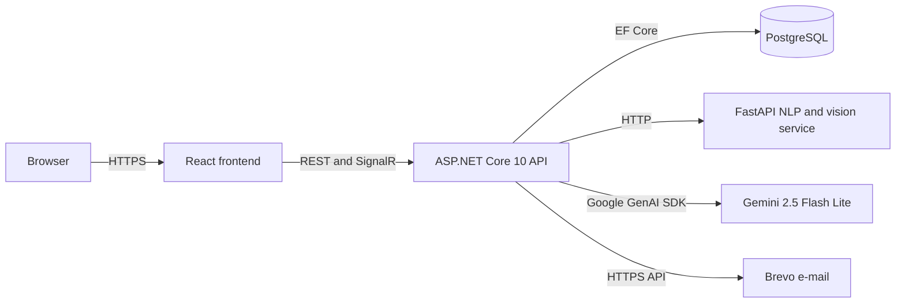
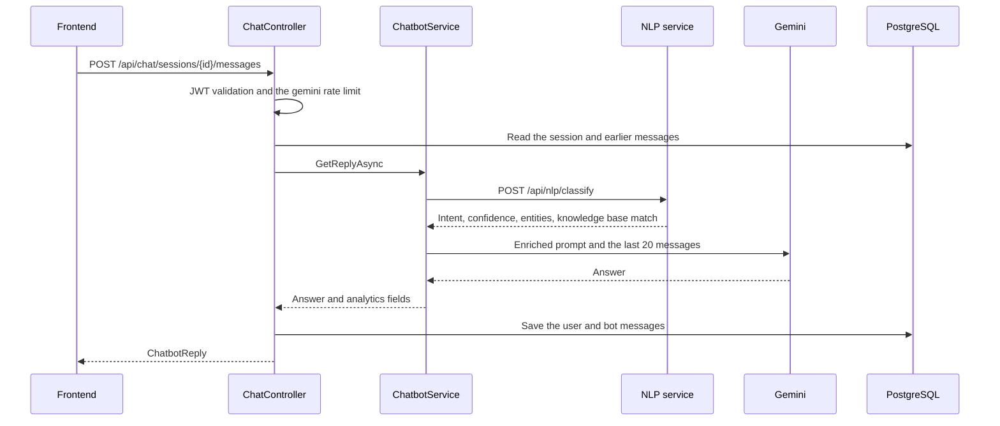

# Architecture

EduConnect runs as three separate services: a React frontend, an ASP.NET Core API and an AI service written in
Python. This document explains how the pieces talk to each other, the layers and the journey of a request.

## The big picture

| Piece | Technology | Where does it run? |
|---|---|---|
| Frontend | React 19, TypeScript, Vite 8, Ant Design 6 | Vercel (today in the in-browser demo mode) |
| API | .NET 10, ASP.NET Core 10, EF Core 10, SignalR | Render, as a Docker container |
| Database | PostgreSQL | Render (the free database has expired) |
| NLP and vision service | Python 3.11, FastAPI, PyTorch, Transformers | Hugging Face Spaces, Docker |
| Language model | Gemini 2.5 Flash Lite | Google AI Studio |
| E-mail | Brevo HTTPS API, SMTP as a fallback | Brevo |

Why it is split this way, and where things stand today, is in [Deployment strategy](09-deployment-strategy.md).

## Layers

The backend has four projects ([EduConnect.sln](../../EduConnect.sln)). Dependencies point inward: Domain depends on
no other project, and Api is the outermost layer.

| Layer | Project | What is inside? |
|---|---|---|
| Domain | [EduConnect.Domain](../../src/EduConnect.Domain) | 27 entities, 6 enums; plain C# with no external dependencies |
| Application | [EduConnect.Application](../../src/EduConnect.Application) | Request and response contracts, service interfaces |
| Infrastructure | [EduConnect.Infrastructure](../../src/EduConnect.Infrastructure) | `AppDbContext`, migrations, identity, Gemini, the NLP client, visual search, file and e-mail services |
| Api | [EduConnect.Api](../../src/EduConnect.Api) | 15 controllers, 3 SignalR hubs, the exception handler, mappers, `Program.cs` |

**To be honest:** the layers look clean on paper, but most business rules live in the controllers and the
controllers use `AppDbContext` directly. MediatR and FluentValidation are registered in the Application layer
([DependencyInjection.cs](../../src/EduConnect.Application/DependencyInjection.cs)), but no handler or validator was
ever written. As a two-person team we chose speed. The cost was large files:
[PostsController](../../src/EduConnect.Api/Controllers/PostsController.cs) has 1,126 lines and
[GroupsController](../../src/EduConnect.Api/Controllers/GroupsController.cs) 757. If I wrote it again today, I would
move rules such as feed scoring and community roles into testable application services.

The complex parts, on the other hand, already live in services: authentication
([AuthService](../../src/EduConnect.Infrastructure/Services/AuthService.cs)), chatbot decisions
([ChatbotService](../../src/EduConnect.Infrastructure/Services/ChatbotService.cs)) and visual search
([VisualSearchService](../../src/EduConnect.Infrastructure/Services/VisualSearchService.cs)).

## Modules

| Module | Controller | Endpoints | What does it do? |
|---|---|---|---|
| Identity | `AuthController` | 7 | Registration, e-mail verification, login, refresh, logout, forgot password |
| Users | `UsersController` | 12 | Profiles, avatar and cover, search, follows, follow suggestions |
| Posts | `PostsController` | 17 | Feeds, tags, likes, bookmarks, views, comments |
| Communities | `GroupsController` | 18 | Communities, membership, roles, community feeds, images |
| Events | `EventsController` | 7 | Events, registration and cancellation, capacity |
| Explore | `ExploreController` | 1 | Live tag trends and suggestions |
| Market | `ProductsController`, `CategoriesController`, `DiscountsController` | 8 | Listings, categories, student discounts |
| Visual search | `VisualSearchController` | 2 | Finding similar listings from a photo, search history |
| Messaging | `ConversationsController` | 4 | One-to-one conversations and messages |
| Notifications | `NotificationsController` | 3 | List, mark as read |
| EduAI | `ChatController` | 8 | Sessions, messages, feedback, admin analytics |
| Other | `UniversitiesController`, `FeedbacksController` | 2 | University list, general feedback |

There are 89 controller endpoints in total; Swagger also shows 89 operations on 69 paths. On top of these there is
`/health` and three SignalR hubs.

## The journey of a request: asking EduAI a question

If Gemini or the NLP service cannot answer, the flow does not stop; [AI](07-ai.md) walks through how it continues.

## Real time

| Hub | Path | What does it carry? |
|---|---|---|
| [ChatHub](../../src/EduConnect.Api/Hubs/ChatHub.cs) | `/hubs/chat` | Asking EduAI over the hub (the UI uses REST today) |
| [DirectMessageHub](../../src/EduConnect.Api/Hubs/DirectMessageHub.cs) | `/hubs/direct-messages` | Delivers a new message to the other person with the `ReceiveMessage` event |
| [NotificationHub](../../src/EduConnect.Api/Hubs/NotificationHub.cs) | `/hubs/notifications` | Delivers a new notification with the `NotificationReceived` event |

The message and notification hubs are empty classes; controllers publish events through `IHubContext`
([NotificationPublisher](../../src/EduConnect.Api/Common/NotificationPublisher.cs)). Browsers cannot send headers in
the WebSocket handshake, so the JWT arrives in the `access_token` query parameter. The notification hub had been left
out of that list; I describe how I noticed in [Problems I solved](11-problems-i-solved.md). If the UI cannot
connect, it refetches messages every 30 seconds and notifications every 60 seconds.

## Runtime

On startup, [Program.cs](../../src/EduConnect.Api/Program.cs):

1. Sets up JWT validation, the CORS list, rate limits, SignalR and an exception handler based on Problem Details.
   Enums are serialized as camelCase strings in JSON (such as `"moderator"`).
2. Serves uploaded files under `/uploads` with a one-year cache header.
3. Applies pending migrations and loads the seed data
   ([DbSeeder](../../src/EduConnect.Infrastructure/Data/DbSeeder.cs)). If it cannot reach the database, it logs a
   warning and starts anyway; that is why today the live API answers `/health` while every request that needs data
   fails.

Swagger is enabled in every environment. In development, two test endpoints are added to try Gemini directly.

## Decision: why is the AI in a separate service?

**Problem.** The BERTurk classifier and ResNet-50, together with PyTorch and Transformers, need gigabytes of memory.
Render's free server has 512 MB.

**Solution.** We put the models into a separate service written with FastAPI and ran it on the free CPU tier of
Hugging Face Spaces. The API talks to it through two narrow contracts: `POST /api/nlp/classify`, and
`POST /api/vision/extract` with `/similarity`.

**Why.** When the model changes, the API does not need a new release, and the Python ecosystem can be updated
independently of .NET. Using the CPU-only build of PyTorch in the Docker image also kept the image smaller.

**Cost.** Every EduAI question means one more network call. A Space that has not been used for a while goes to sleep,
and the first request waits while the model loads into memory. We balanced this by continuing with a safe fallback
result when the service is unreachable
([NlpApiService](../../src/EduConnect.Infrastructure/Services/NlpApiService.cs)).
