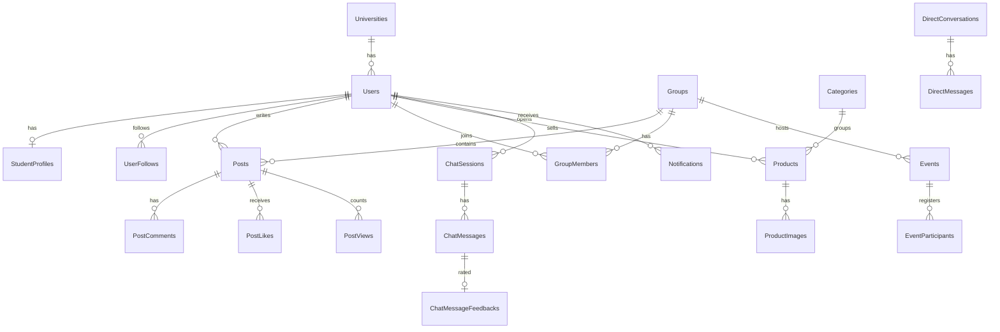

# Database

The database is PostgreSQL, and EF Core generates the schema from code. The whole configuration lives in one file:
[AppDbContext.cs](../../src/EduConnect.Infrastructure/Data/AppDbContext.cs). There are 27 tables, one per entity.

## Relationship diagram

The diagram shows the most important relationships; all of them are in the `Configure...` methods of `AppDbContext`.

## Tables

| Group | Tables | Count |
|---|---|---|
| Identity | `Users`, `StudentProfiles`, `Universities`, `RefreshTokens`, `UserFollows` | 5 |
| Sharing | `Posts`, `PostComments`, `PostLikes`, `PostBookmarks`, `PostViews` | 5 |
| Communities and events | `Groups`, `GroupMembers`, `Events`, `EventParticipants` | 4 |
| Market | `Categories`, `Products`, `ProductImages`, `Discounts`, `VisualSearchHistories`, `VisualSearchResults` | 6 |
| Messages and notifications | `DirectConversations`, `DirectMessages`, `Notifications` | 3 |
| EduAI | `ChatSessions`, `ChatMessages`, `ChatMessageFeedbacks` | 3 |
| Other | `Feedbacks` | 1 |

## Key decisions

### Timestamps in one place

**Problem.** If every controller filled `CreatedAtUtc` and `UpdatedAtUtc` itself, one forgotten field would lead to
wrong ordering.

**Solution.** For every record that derives from `AuditableEntity`, `SaveChanges` and `SaveChangesAsync` fill these
fields centrally ([AppDbContext.cs](../../src/EduConnect.Infrastructure/Data/AppDbContext.cs), `ApplyAuditing`).
Identifiers (`Guid`) are generated in the application.

**Cost.** Bulk updates such as `ExecuteUpdate` bypass this method; where we used them (refresh tokens, the visual
embedding cache) no timestamp was needed.

### One like per user and post

**Problem.** Two like requests arriving at the same moment could create two rows and inflate the count.

**Solution.** We put the rule into the database: in `PostLikes`, `PostBookmarks` and `PostViews` the
`(PostId, UserId)` pair is unique. The second request gets error `23505` from PostgreSQL, and the backend reads it as
"already done"
([DbUpdateExceptionExtensions](../../src/EduConnect.Infrastructure/Extensions/DbUpdateExceptionExtensions.cs)).

**Why.** "Check first, then insert" is not enough on its own in the application: two requests can pass the check at
the same time. The unique index guarantees the right result no matter who wins the race.

### One conversation between two people

**Problem.** "Ali-Ayşe" and "Ayşe-Ali" could be opened as two separate conversations.

**Solution.** The `DirectConversations` table stores the two users as `UserLowerId` and `UserHigherId`, so always in
the same order, and that pair is unique. Whoever starts the conversation, the same row is found
([ConversationsController](../../src/EduConnect.Api/Controllers/ConversationsController.cs)).

### Deactivate instead of delete

Posts are deactivated with `IsDeleted`, communities and listings with `IsActive`. Events and posts of a deleted
community stay in the history; feed queries filter them out.

### Delete behavior was chosen on purpose

| Behavior | Where? | Why? |
|---|---|---|
| `Restrict` | Posts, comments, likes and listings that belong to a user | Deleting a user should not silently wipe out history |
| `Cascade` | A post's comments and likes, a conversation's messages, a session's messages | Records with no meaning without their parent |
| `SetNull` | `Posts.GroupId`, `Events.GroupId`, `Products.CategoryId` | The record should survive even if the community or category is removed |

### Flexible fields as text

Community rules (`RulesJson`) and the ResNet-50 embeddings of product images (2,048 numbers, `EmbeddingJson`) are
stored as JSON in text columns. We kept it simple; the cost is that the database cannot run a similarity search over
the embeddings. For a large catalog I would use `pgvector`.

## Rules the database enforces

| Rule | How? |
|---|---|
| One account per e-mail | `Users.Email` is unique |
| A refresh token belongs to one user | `RefreshTokens.Token` is unique |
| A user follows someone once | `(FollowerUserId, FollowedUserId)` is unique |
| One like, one bookmark, one view | `(PostId, UserId)` is unique |
| A user joins a community once | `(GroupId, UserId)` is unique |
| One registration per event | `(EventId, UserId)` is unique; a cancelled registration is reactivated |
| Unique community address | `Groups.Slug` is unique |
| One feedback per bot message | `ChatMessageFeedbacks.ChatMessageId` is unique |

## From SQL Server to PostgreSQL

We started with SQL Server, the most common choice in the .NET world. When deploying, we found that Render's free
tier has no SQL Server, and on 26 May 2026 we moved to PostgreSQL:

1. We switched the EF Core provider to Npgsql.
2. We deleted the 11 SQL Server migrations and generated a single `InitialPostgresCreate` migration
   ([Migrations](../../src/EduConnect.Infrastructure/Data/Migrations)).
3. We fixed type-specific mappings: `text` instead of `nvarchar(max)`, `double precision` instead of `float`.
4. We turned on the switch that keeps Npgsql's legacy `timestamp` behavior instead of the strict one.
5. We wrote a one-off console tool to move the existing data: [tools/MigrateData](../../tools/MigrateData); its story
   is in [Problems I solved](11-problems-i-solved.md).

On startup the API applies pending migrations and loads the seed data: 2 universities, 4 categories, 1 admin account
and 2 discounts ([DbSeeder](../../src/EduConnect.Infrastructure/Data/DbSeeder.cs)). The admin's e-mail is not seeded as
verified; [Running and API](10-running-and-api.md) shows how to verify it locally.

## Known gaps

- **Event capacity is not enforced by the database.** Capacity is counted and checked in the application; two
  registrations arriving at the same time can exceed it by one. A row lock (`SELECT ... FOR UPDATE`) or a conditional
  `INSERT` would close this.
- **No date index for feed ordering.** The `Posts` table only has foreign key indexes; once the number of posts grows,
  an index on `CreatedAtUtc` will be needed.
- **Refresh tokens are stored in plain text.** Details in [Security](06-security.md).
