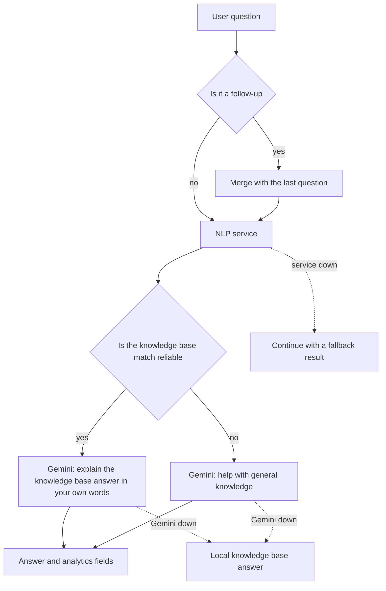

# AI: EduAI and visual search

The two most original parts of the project are here. EduAI is an assistant that answers university questions based on
official sources. Visual search finds similar listings in the market from a product photo. In both, designing what
happens when the model is wrong or the service is down mattered as much as the model itself.

## How EduAI works



## 1. The NLP service: intent, entities and the knowledge base

The FastAPI service in the [nlp-service](../../nlp-service) folder does three jobs in a single call
([routers/nlp.py](../../nlp-service/routers/nlp.py)):

**Intent classification.** We fine-tuned `dbmdz/bert-base-turkish-cased` (BERTurk) on our own dataset
([train_intent.py](../../nlp-service/training/train_intent.py)). There are 7 intents: exams and grades, course
registration, digital systems, student affairs, the library, student life, and scholarships and support. The dataset
has 1,739 examples. With 3 epochs, a batch size of 16 and a learning rate of 2e-5, the best validation accuracy was
**0.9626** ([metrics.json](../../nlp-service/models/intent_classifier/metrics.json)).

This number needs to be read carefully: most of the dataset consists of sentences generated from rules and then
augmented, and the validation set was split from the same distribution. Accuracy on real student questions may be
lower. For that we prepared a separate set of 60 hard cases
([phase_c_hard_test.json](../../nlp-service/data/phase_c_hard_test.json)); we did not commit the results, so I am
not quoting a number here.

**Knowing when not to trust the model.** [intent_service.py](../../nlp-service/services/intent_service.py) follows
these rules:

- If the accuracy in `metrics.json` is below 0.60, or the model file cannot be loaded, the service does not use
  BERTurk at all and starts with the keyword classifier.
- If the model's confidence is below 0.60, or the gap between the top two predictions is smaller than 0.15, the
  keyword classifier is consulted too (`hybrid-fallback`).
- A rule-based resolver handles areas that get confused: "VPN" goes to digital systems unless it appears together with
  the library's remote access terms, and double major (ÇAP) and minor go to course registration.
- Confidence band: 0.85 and above is high, 0.60 and above is medium, anything lower is low.

**Entity extraction.** 105 aliases in 9 groups (units, systems, documents, campuses...) and time expressions such as
"when" or "what time" are searched in the text
([entity_dictionary.json](../../nlp-service/data/entity_dictionary.json)).

**Knowledge base search.** [knowledge_base.json](../../nlp-service/data/knowledge_base.json) holds 412 entries: 356
with high confidence, 56 with medium confidence, and 61 time-sensitive ones (dates, fees and other information that
can change). Most sources are the university's official pages; entries were compiled from PDFs such as the 2025
Student Handbook, the 2025-2026 academic calendar and the contact document. An entry's score
([knowledge_service.py](../../nlp-service/services/knowledge_service.py)):

| Component | Weight |
|---|---|
| Share of matched keywords | 0.45 |
| Overlap with the question's words | 0.25 |
| Overlap with topic terms | 0.10 |
| Extracted entities appearing in the text | 0.20 |
| Exact question match / high-confidence entry / time-sensitive entry | +0.10 / +0.05 / −0.05 |

The threshold is 0.18; it is 0.06 higher for medium-confidence entries and 0.05 higher for time-sensitive ones.
Before comparing, the text is lowercased and Turkish characters are simplified.

## 2. The backend: the layer that decides

[ChatbotService](../../src/EduConnect.Infrastructure/Services/ChatbotService.cs) looks at the NLP result and decides
what kind of prompt goes to Gemini.

**Grounding in the knowledge base.** An answer counts as "grounded" when the match score is at least 0.40, the entry is
not both medium-confidence and time-sensitive, and either the intent confidence is at least 0.70 or the score is at
least 0.35. If it is grounded, Gemini is asked to explain the knowledge base answer in the user's language. If not, it
is asked to help with its general knowledge and to use a weak match only as a hint.

**Catching deflecting answers.** Some knowledge base entries said things like "follow the announcements" without any
concrete information. An answer shorter than 300 characters that contains such phrases counts as a deflection; Gemini
is asked to give a concrete answer instead of repeating it, and to add the link only as a source
(`IsDeflectingKbAnswer`).

**Follow-up questions.** "Could you explain a bit more?" means nothing on its own. If a message is short or contains a
typical follow-up phrase, it is sent to the classifier together with the last question, and Gemini is told not to
repeat its earlier answer. The last 20 messages go to Gemini as history.

**Links.** The model sometimes writes a link without a scheme, like `oidb.erdogan.edu.tr`. Links in the answer are
completed with `https://` so they are clickable in the UI.

**Analytics.** Every bot message is stored with the intent, the confidence, the model used, the knowledge base score,
whether there was a match, whether a fallback path was taken and the latency. The admin-only
`GET /api/chat/analytics/summary` turns this into a helpfulness rate, a knowledge base hit rate, the intent
distribution and the last 20 unresolved questions. An honest note: the feedback (helpful / not helpful) endpoint is
ready, but the UI does not call it yet, and there is no screen for the analytics.

## 3. When something breaks

| What happened? | What does the system do? | What does the user see? |
|---|---|---|
| The NLP service is unreachable | Intent `student_services`, confidence 0.3, model `fallback` | Gemini still answers; the confidence band is low |
| Gemini did not answer or the quota ran out | A local answer: the knowledge base answer and source if grounded | Model label `...+local-kb` |
| No Gemini, weak match | A close answer starting with "Tam emin değilim ama..." ("I'm not entirely sure, but...") | With the source link |
| Neither is available | A short apology | Never an empty screen |

I tried this on the local setup without a Gemini key. The real service on Hugging Face classified the question, and
the answer came from the knowledge base:

```json
{
  "intentDetected": "library",
  "confidence": 0.885,
  "confidenceBand": "high",
  "modelUsed": "berturk-finetuned+local-kb",
  "kbScore": 0.6583,
  "kbHit": true,
  "latencyMs": 1686
}
```

Before this test, EduAI did not work at all in a setup without a key; I explain why in
[Problems I solved](11-problems-i-solved.md).

**Cost.** The system prompt asks Gemini to give a "typical" estimate on topics it does not know and to point out the
uncertain part in one sentence at the end. This keeps the user from leaving empty-handed, but it raises the risk of
wrong information. We tried to reduce that risk by showing the confidence band, the knowledge base label and the
source link with every answer.

## Visual search

The user uploads a photo and the system ranks similar listings in the market
([VisualSearchService](../../src/EduConnect.Infrastructure/Services/VisualSearchService.cs)).

1. **Two analyses in parallel.** Gemini describes the image as JSON (product name, category, keywords, condition,
   estimated price range). At the same time the NLP service extracts a 2,048-dimensional image vector with ResNet-50.
2. **Candidates.** Active listings with images; category, price and city filters apply.
3. **Heuristic score.** Text 0.40, category 0.30, condition 0.15 and price proximity 0.15
   ([VisualSearchScoringHelper](../../src/EduConnect.Infrastructure/Services/VisualSearchScoringHelper.cs)).
4. **Visual similarity.** Cosine similarity with the vectors of listing images. When both scores exist, the total is
   0.45 × heuristic + 0.55 × visual.
5. **Threshold.** In strict mode 0.42, plus either a visual similarity of at least 0.55 or a text score of at least
   0.08; in explore mode 0.32. If nothing passes the threshold in explore mode, the closest listings are still shown.
6. **Explainability.** Every result comes with a score breakdown (category, text, condition, price, visual) and the
   signals that matched.

**A lazy cache.** The vector of a listing image is computed during the first search and written to the
`EmbeddingJson` column with a single `ExecuteUpdate`; later searches reuse it.

**Cost.** Similarity is computed for all candidates on every search, and the vectors are stored as text in the
database. That is enough at the scale of a student market; with thousands of listings it would need `pgvector` and an
approximate nearest neighbor search. If Gemini or the vision service fails, the search does not stop; it continues
with the heuristic score only.

## What runs in the demo?

Running BERTurk or Gemini in the browser is not possible. The live demo brings the real system's Gemini-free fallback
path into the browser: the keyword classifier and the knowledge base scoring, ported to TypeScript and running on the
same 412 entries ([engine.ts](https://github.com/mrfiratatalay/educonnect-frontend/blob/main/src/demo/eduai/engine.ts)).

There are two deliberate differences. The demo simplifies Turkish characters before classifying, and if it finds no
match in the predicted intent it searches the whole knowledge base. The keyword fallback in Python does not simplify
Turkish characters; that is a known weakness of the real system. Visual search in the demo guesses the product from the
file name, but ranks results with an exact copy of the backend's heuristic scoring.
