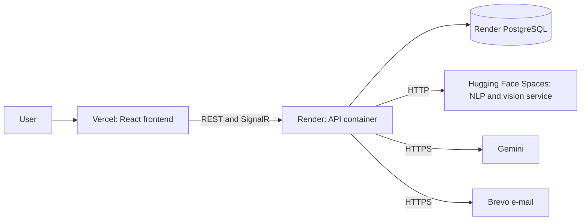
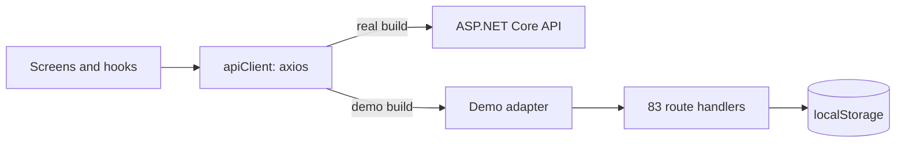

# Deployment strategy

We kept EduConnect online without spending any money. This document explains how the free tiers shaped the
architecture, why in November 2026 I turned the live site into a demo that runs in the browser, and what that cost.

## May 2026: three free providers



| Piece | Provider | Free tier constraint | What the constraint turned into |
|---|---|---|---|
| Frontend | Vercel | Enough for a static site | Automatic deploys on every push to `main` |
| API | Render, Docker | 512 MB of memory; sleeps when idle | The AI models moved into a separate service |
| Database | Render PostgreSQL | It expires | We moved from SQL Server to PostgreSQL; when it expired, the site went empty |
| NLP and vision service | Hugging Face Spaces | CPU only; sleeps when idle | CPU-only PyTorch; a fallback result if the service is down |
| E-mail | Brevo | Render blocks SMTP ports | Sending through an HTTPS API, SMTP as a fallback |
| Language model | Gemini (Google AI Studio) | Quota | A limit of 30 requests per minute and a local knowledge base fallback |

There are two Docker images:

- **API:** the [Dockerfile](../../src/EduConnect.Api/Dockerfile) has two stages. It builds with `sdk:10.0` and runs on
  `aspnet:10.0` on port 8080.
- **NLP service:** [nlp-service/Dockerfile](../../nlp-service/Dockerfile) installs CPU-only PyTorch 2.5 on top of
  `python:3.11-slim` and exposes port 7860, which Hugging Face Spaces expects. Skipping the CUDA build of PyTorch keeps
  the image smaller.

The e-mail service checks for a Brevo key first; with a key it uses the HTTPS API, otherwise SMTP
([EmailService](../../src/EduConnect.Infrastructure/Services/EmailService.cs)). In the local setup SMTP goes to
Mailpit.

## November 2026: the live site opened empty

A few months after we submitted the project, I opened the live address: the UI loaded, but nobody could log in.
Render's free database had expired. The API returned 200 for `/health`, while every endpoint that needed data waited
about 26 seconds and then failed:

```json
{"title":"Invalid Operation","status":400,"detail":"An exception has been raised that is likely due to a transient failure."}
```

A recruiter or an interviewer clicking the link and seeing this would assume the project never worked. Paying every
month for a server and a database was not something I could afford as a new graduate.

## The solution: two channels

| Channel | For whom? | What is there? |
|---|---|---|
| **Live demo** | Recruiters, anyone taking a first look | On Vercel, no backend; one-click login with every role, full of sample data |
| **Real system** | Engineers | The code, these documents and a one-command local setup (`docker compose up --build`) |

## How does the demo work?



**Swapping at the transport layer.** The demo replaces axios's adapter. Screens and hooks call the same paths and get
the same field names and error codes
([adapter.ts](https://github.com/mrfiratatalay/educonnect-frontend/blob/main/src/demo/adapter.ts)). The adapter routes
each request to a route handler in the browser; there are 83 routes in 9 files. To behave like the real API, every
response waits a random 90 to 250 ms. A request to a protected endpoint without a token gets a 401, and an endpoint
the demo does not have gets a 404.

**Realtime events.** Instead of SignalR there is an in-browser event bus
([realtime.ts](https://github.com/mrfiratatalay/educonnect-frontend/blob/main/src/demo/realtime.ts)). Events carry
the same names and payload shapes as the real hubs (`ReceiveMessage`, `NotificationReceived`). When you send a
message, the other person replies within a few seconds and the notification count goes up.

**Data.** Sample data is generated on the first visit and written to `localStorage` under the `educonnect-demo-db`
key: 16 users, 7 communities, 30 posts, 8 events, 13 listings, 5 discounts, 11 notifications, 4 conversations and 1
EduAI session. The names are Turkish and made up; there is no real personal data. E-mail addresses use the
`@demo.erdogan.edu.tr` domain.

**The demo never looks stale.** Every date is generated relative to the moment of the visit. When a visitor comes back
days later, all stored dates move forward by the number of whole days that passed
([db.ts](https://github.com/mrfiratatalay/educonnect-frontend/blob/main/src/demo/db.ts),
[time.ts](https://github.com/mrfiratatalay/educonnect-frontend/blob/main/src/demo/time.ts)). Hours are not shifted,
but a post still looks shared a few hours ago and next week's event is still next week.

**No trace in the real build.** `__DEMO_MODE__` becomes a constant at build time through Vite's `define` setting
([vite.config.ts](https://github.com/mrfiratatalay/educonnect-frontend/blob/main/vite.config.ts)). In the real build
its value is `false`, so the demo branches and dynamic imports drop out of the bundle completely; I verified this by
searching the built files. In the demo build the main bundle grows by only 8 KB. The demo backend loads in separate
chunks on the first request:

| Chunk | Size | gzip |
|---|---|---|
| Demo adapter and handlers | 95.8 KB | 32.5 KB |
| Knowledge base (412 entries) | 238.6 KB | 54 KB |
| Entity aliases | 6.8 KB | 1.2 KB |

**Hosting.** [vercel.json](https://github.com/mrfiratatalay/educonnect-frontend/blob/main/vercel.json) tells Vercel
two things: build with `npm run build:demo`, and route every path to `index.html`. Thanks to the second one, reloading
a page like `/market` opens the app instead of a 404.

## The cost

| What I gave up | Why it is acceptable | How I reduced the risk |
|---|---|---|
| The live address does not run the real backend | What matters to a recruiter is trying the product; an engineer can run the real system with one command | The demo says so on every screen; the differences are in a table in [Demo tour](02-demo-tour.md) |
| Maintaining two "backends" | If the API changes, the demo handlers must change too | The screen code is shared. The remaining risk: demo responses are shaped by the mappers (`mappers.ts`), not by the app's own types, so the compiler does not catch a mismatch |
| EduAI in the demo is not BERTurk | Running a model in the browser is not practical | The real system's Gemini-free fallback path runs on the same 412 entries |
| No real image analysis in visual search | Gemini and ResNet-50 are not in the browser | The product is guessed from the file name; ranking is a copy of the backend's heuristic scoring |
| A slightly larger demo build | The main bundle grows by only 8 KB | Demo code lives in separate chunks and is absent from the real build |

Tying the demo mappers to the app's own types (`src/types`) is the first item on this list.

## The real system: one command

[docker-compose.yml](../../docker-compose.yml) defines four services:

| Service | Image | Port |
|---|---|---|
| `db` | `postgres:16-alpine` | 5433 |
| `mail` | `axllent/mailpit:v1.27` | 8025 |
| `api` | [src/EduConnect.Api/Dockerfile](../../src/EduConnect.Api/Dockerfile) | 5160 |
| `nlp` (optional, `ai` profile) | [nlp-service/Dockerfile](../../nlp-service/Dockerfile) | 8000 |

No secrets are needed. Without a Gemini key, EduAI answers from the local knowledge base. The commands, with a tour
of real outputs, are in [Running and API](10-running-and-api.md).

## Where things stand (November 2026)

| Address | Status |
|---|---|
| [educonnect-tez.vercel.app](https://educonnect-tez.vercel.app) | The in-browser demo |
| Render API | `/health` answers; endpoints that need data fail because there is no database |
| [Hugging Face Space](https://firatatalay-educonnect-nlp.hf.space) | Running; sleeps after a long idle period, and the first request waits while the model loads |

The local setup uses the live Space as well, which is why EduAI runs on the real BERTurk model locally too.

## What I would do with a budget

- A managed PostgreSQL and a small server that does not sleep. I would point the live address at the real system and
  keep the demo on a separate address.
- Uploaded files in object storage; on Render the container's disk is not persistent.
- The UI and the API under the same domain, so the refresh cookie is no longer cross-site.
